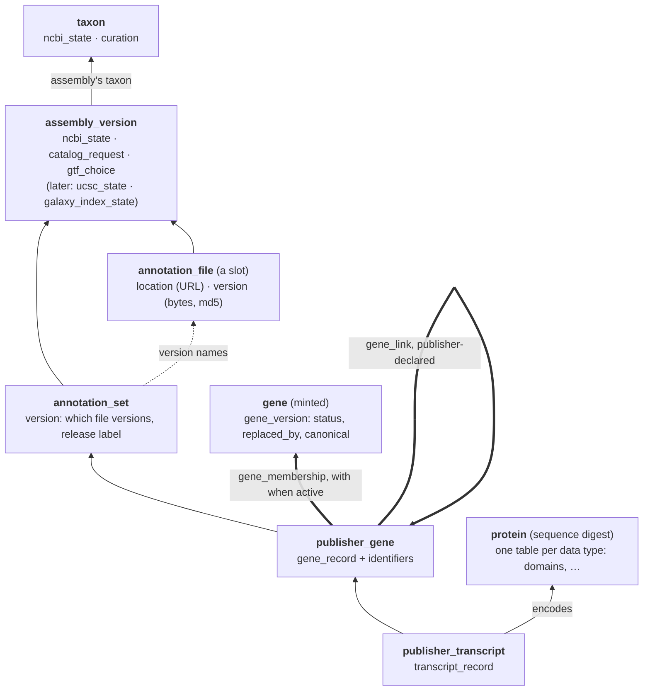

# Gene Annotation Schema

Draft, 2026-10-08; updated 2026-10-27. Related: #1776 (gene pages), #1777 (gene list prototype), #1783 (gene search API). **Where this differs from [gene-catalog-contract.md](gene-catalog-contract.md), the contract wins** (terms, table columns, field names, scope). Its "v1 (P01)" predates the contract's scope: the contract's v0 is gene pages from the publisher's files, and its v1 adds linking workflow runs through their GTFs.

The tables that hold what [gene-provenance-spec.md](gene-provenance-spec.md) requires. The spec is the background and requirements; this doc is the database design. Terms (annotation set, annotation file, gene record, canonical record) are defined in the spec's Key terms. This doc refines two: an **annotation file** is a slot ("UCSC's augustus GTF for this assembly"), not a URL; the **canonical record** is the latest gene record of a gene's canonical publisher gene.

## Principles

- **Insert-only.** No row is edited after it is written. A change adds a row. So the database can answer "what did we know on date T".
  - **Why: nobody else keeps this history.** UCSC overwrites GTFs in place under the same URL. NCBI changed P01's genes under the same release label (2020-06-17). 321 of the catalog's 2,419 UCSC `ncbiGene` and `ncbiRefSeq` GTFs (13%) were built before NCBI last changed the annotation's locations, a median of 179 days before (#1874, GenArk GTFs behind NCBI's annotation; checked 2026-10-15). If we don't record what we saw and when, it's gone. Archived copies keep the bytes; only the database keeps what we concluded from them.
  - **Use cases that need it:**
    1. **"What annotation did my analysis use?"** A workflow run launched from BRC Analytics since 2026-01-14 carries its GTF's md5, readable from Galaxy through the run's landing request (path checked 2026-10-14 on an older run; a run since 2026-01-14 still to confirm). Only a record of every annotation file version we've seen turns that md5 into "RefSeq `RS_2025_…`, as of March". A v1 use case in the spec.
    2. **"Why does my result disagree with the gene page?"** The run used last year's GTF; the page shows this year's. Explaining it needs both versions on record.
    3. **Stable gene pages.** A gene keeps its `gene_uid`, and so its URL, because each refresh matches new records against the previous state. History explains why a gene kept or lost its `gene_uid`, and lets us replay refreshes if a merge or split rule turns out wrong, instead of breaking URLs.
    4. **Drift report (#1819, weekly catalog drift report).** "What changed since the last run" is a diff of two runs; change-only rows are that diff.
    5. **Pages and exports can be explained later.** What a gene page, a download or the assistant said on a date can be rebuilt.
  - **Assemblies are the weak case.** NCBI keeps assembly revision history itself. Assembly NCBI state history is kept because it costs nothing extra in the same pattern, and use case 1 joins a run to the assembly version's state at the time ("your run used `.2`, which NCBI had already replaced"). If we need to cut, keep the `assembly_version` hub and store only NCBI's current status. Our own decisions (`assembly_catalog_request`) are not the weak case: the satellite is the queryable record of what we decided and when, which git history only gives with digging.
- **Every entity has its own UUID and version.** An entity's identity is a UUID; its natural key is a unique column, not the key. **How the UUID is made depends on whether a stable natural key exists:**
  - **Derived from the natural key** (a name-based UUID, UUIDv5, or Data Vault's hash key) where the natural key is stable and never reused: `taxon` (`NCBITaxon:5833`), `assembly_version` (`GCA_000002765.3`), `annotation_set` (assembly + publisher), `annotation_file` (provider + assembly + publisher's track or file name), `publisher_gene` (annotation set + publisher gene ID). The same natural key always gives the same UUID, on every rebuild and machine, so loading needs no lookup. Natural keys carry a source prefix where more than one source could supply them (`NCBITaxon:`, later `GTDB:`).
  - **Minted once** (a random UUID) where identity must outlive changing IDs: `gene_uid`, because a gene's IDs are renamed, merged and split. A gene's identity is our conclusion from regrouping publisher genes, so there is nothing stable to hash.
  - Every hub's key is a UUID either way, for consistency: one key type, one join pattern.
  - A merge (taxon or gene) never changes a key. The old hub row stays and gets a "merged into" state row.
  - **Versions:** each version is numbered from 1 within its entity and keyed by UUID + version, cited as `<uuid>@<version>`. Immutable facts get a UUID and no version. **Numbers are for citing:** a satellite nothing cites (assembly, taxon and membership states, locations, the catalog's GTF choice) is keyed by UUID + `load_date` instead: the Data Vault load date, the start time of the refresh run that wrote the row. `gene_record` is keyed by the annotation set version that changed it. `gene_version` has both: a number, for internal use only (users see the date a gene changed, never the number; decided 2026-10-26), and a unique `load_date`, so "the gene on date T" needs no join.
- **Versioned on our clock, not the publisher's.** Every row is stamped with the refresh run that wrote it (`run_uid`, or `load_date`, the run's start time). The publisher's release label and release date are data on the annotation set, not a second time axis.
- **Projections for reading.** The site and DuckDB read current-state tables rebuilt from these tables after each refresh (see Projections). Nothing reads the insert-only tables to render a page.
- **Built for 100k assemblies.** About 100k assemblies are coming, each with up to 4 GTFs, and gene records in the hundreds of millions (estimate). So rows are written only on change, never as monthly snapshots, and queries go to projections, never the insert-only tables.
- **No gene models in v1.** Records hold genome location and `model_hash`; UCSC draws the gene model (spec: Deferred: storing gene models).

## Overview: write model and read model

- **Write model** (the record): hubs, satellites and links, insert-only. Each refresh writes what changed. Nothing reads it to render a page.
- **Read model** (projections): a few flat tables rebuilt from the write model each refresh and exported as Parquet. The site, the search API and the assistant read only these.

### Write model

Boxes are hubs (identities, written once), with their satellites listed inside (what each source says, change-only). Thick arrows are links between hubs; thin arrows are pointers that never change.



### Read model

The read model's shape (one main table with the transcripts, a table of alternative IDs, an optional version history, one table per data type) follows a proposal from Max Haeussler (UCSC Genome Browser).

| Table             | One row per                    | Holds                                                                                                                                                                                                                                                                                                                                                                                                                                                                                                                                                                                 | From                                                                                                                      |
| ----------------- | ------------------------------ | ------------------------------------------------------------------------------------------------------------------------------------------------------------------------------------------------------------------------------------------------------------------------------------------------------------------------------------------------------------------------------------------------------------------------------------------------------------------------------------------------------------------------------------------------------------------------------------- | ------------------------------------------------------------------------------------------------------------------------- |
| `transcript`      | transcript                     | the main table: gene, transcript and protein IDs, location, product, biotype, protein digest; gene columns repeat per transcript                                                                                                                                                                                                                                                                                                                                                                                                                                                      | latest `gene_record` and `transcript_record` of each current gene's canonical publisher gene                              |
| `alt_id`          | ID × gene                      | every ID that finds a gene or transcript: locus tags, GeneIDs, symbols, previous IDs, accessions, and the transcript IDs in each mapped GTF (UCSC's split P01 GTF names exon pieces `VUZ95756.1_2`, so pasted StringTie IDs still find the gene). Each row says **current or historical**, from and to (from the membership's active dates), and which publisher says so, so `PF11_0344` finds AMA1 with "previous ID for `PF3D7_1133400` (per PlasmoDB)". Publisher-declared previous IDs (`old_locus_tag`, VEuPathDB previous IDs) are historical even if we never saw them current | `gene_identifier`, transcript and protein accessions, `gene_link`, ended memberships, `gtf_gene_map` GTFs' transcript IDs |
| `gene_change`     | change                         | renamed, modified, merged, split, retired, with dates and releases. Optional to show; always recorded                                                                                                                                                                                                                                                                                                                                                                                                                                                                                 | `gene_version`, `gene_membership_state`, change-only `gene_record` rows                                                   |
| `gtf_gene_map`    | GTF version × GTF gene × gene  | which gene each `gene_id` in one exact GTF is: GTF md5, assembly, GTF `gene_id`, NCBI locus tag and GeneID, `gene_uid`. A merged `gene_id` (`lpdA`) has a row per gene; a GTF gene NCBI no longer has gets an empty NCBI side. Built for every GTF version we see, linked or not, so a run's md5 and a counts row's `gene_id` lead to a page in one lookup                                                                                                                                                                                                                            | the GTF's and the publisher's CDS, matched by overlap                                                                     |
| one per data type | item × protein (e.g. a domain) | e.g. `protein_domain`: domain accession, start, end, source and source release                                                                                                                                                                                                                                                                                                                                                                                                                                                                                                        | the data type's own satellite on `protein`                                                                                |

Plus the catalog projections (assemblies, organisms, annotation files) in Projections.

**Build order: the write model starts in the contract's v0, with eight tables.** v0 writes `annotation_set`, `annotation_set_version`, `annotation_file`, `annotation_file_location`, `annotation_file_version`, `publisher_gene`, `gene` and `gene_membership`, in this doc's names and keys, so that later work only adds tables (the contract's "provenance database", section 4). v0 stores no gene records: the gene page snapshot reads genes straight from the archived files. The rest of the write model (`gene_record`, `gene_version`, transcripts, links and the assembly and taxon tables) follows after the contract's v1, as new tables, and from then on the snapshot is rebuilt from it. Two things carry over from day one, because they can't be recovered later:

- **Archived copies** of every GTF and GFF3 read, with `sha256`, `md5` and fetch date, so the write model can be backfilled from them.
- **`gene_uid`s stay fixed.** Pages use them in URLs from v0, and they are minted into `gene` and linked by `gene_membership` from the first update.

**History is optional to show, not to record.** If the write model doesn't capture a change at the refresh that sees it, it can be added later only from files we archived, because publishers overwrite their files. VEuPathDB is the exception: it keeps every release back to release 24, so its past changes can be rebuilt (`gene-history-findings.md`). Change-only rows make recording cheap; `gene_change` can wait until someone wants it on a page.

## Versioned entities

A versioned entity has a stable identity and a state that changes over time; each change is a new version. Everything else is an **immutable fact**: written once, true forever about the thing it describes.

| Entity              | Identity                                                                                                                                               | Version                                                                                                                               | New version when                                                              |
| ------------------- | ------------------------------------------------------------------------------------------------------------------------------------------------------ | ------------------------------------------------------------------------------------------------------------------------------------- | ----------------------------------------------------------------------------- |
| **Annotation set**  | `annotation_set_uid`; unique on assembly + publisher                                                                                                   | **Annotation set version:** one state of the publisher's content, with the publisher annotation file version its genes were read from | the release label, core hash or content hash of the publisher's file changes  |
| **Annotation file** | `annotation_file_uid`; unique on provider + assembly + publisher's track or file name, plus the release where it's in the path (the slot, not the URL) | **Annotation file version:** the bytes (`sha256`, `md5`), with date                                                                   | the bytes change                                                              |
| **Publisher gene**  | `publisher_gene_uid`; unique on annotation set + publisher gene ID                                                                                     | **Gene record:** what the publisher says about the gene (location, product, biotype, `model_hash`)                                    | the publisher's facts about that gene change, or the gene goes from a release |
| **Gene**            | `gene_uid` (minted)                                                                                                                                    | **Gene version:** status, replacements, canonical publisher gene; which publisher genes belong to it is the `gene_membership` link    | a refresh changes any of them                                                 |

**Every annotation file version points to the annotation set version whose content it holds or copies**, set when the row is written. A later rewrite of the publisher's file with the same content points to the same annotation set version, and so does each matching UCSC copy. A workflow run's GTF, found by its md5, leads to exactly one annotation set version, which names the GFF3 its genes were read from.

**Gene records are written only when a gene changes.** A byte-only change (same core and content hash) writes no gene rows. A content change compares every gene, but writes a gene record only for each publisher gene whose facts differ from its latest record (`hashdiff`), plus one "absent" record for each gene the release dropped. A release that changes 50 of 5,000 genes writes about 50 records, not 5,000.

**A UCSC annotation file version points to an annotation set version only if its core hash matches** that version's publisher annotation file version. One that doesn't match is recorded as an annotation file version that points to none, and puts the assembly on the work queue.

**Immutable facts**, each tied to the version it came from:

- **Gene identifier:** one gene-level ID on a gene record, with its type (locus tag, NCBI GeneID, VEuPathDB gene ID, symbol, old locus tag, previous ID). Many per gene record; written only with a new gene record.
- **Transcript record:** one transcript of a gene record, with its transcript accession and the protein accession of its coding sequence, each with type and version. Many per gene record; written only with a new gene record.
- **Gene link:** two publisher genes are the same gene, or one replaced the other, as declared by a publisher (RefSeq's `CWE02_RS00005` replaced GenBank's `CWE02_00005`, per `old_locus_tag`). (Inferred links, later, can be withdrawn; see Open questions.)
- **Publisher check:** what a publisher reported when we asked, changed or not.

### Data Vault roles

Every table is insert-only. "Changing" an entity adds a version row; the current state is a projection.

| Table                                                                | Role                                                                                        | Key                                                                                                        | Rows ever change?       |
| -------------------------------------------------------------------- | ------------------------------------------------------------------------------------------- | ---------------------------------------------------------------------------------------------------------- | ----------------------- |
| `assembly`                                                           | **Hub:** identity of one assembly series (`GCA_000002765`)                                  | `assembly_uid` (natural key: accession without version)                                                    | No                      |
| `assembly_version`                                                   | **Hub:** identity of one assembly version, a fixed set of sequences (`GCA_000002765.3`)     | `assembly_version_uid` (natural key: versioned accession)                                                  | No                      |
| `assembly_ncbi_state`                                                | **Satellite** of `assembly_version`: what NCBI says (status, name, release date)            | `assembly_version_uid` + `load_date`                                                                       | No; a change adds a row |
| `assembly_catalog_request`                                           | **Satellite** of `assembly_version`: our decisions (requested, removed), by whom            | `assembly_version_uid` + `load_date`                                                                       | No; a change adds a row |
| `assembly_ucsc_state`                                                | **Satellite** of `assembly_version`: what UCSC has (hub present, built date)                | `assembly_version_uid` + `load_date`                                                                       | No; a change adds a row |
| `assembly_galaxy_index_state`                                        | **Satellite** of `assembly_version`: what Galaxy has (indexes present)                      | `assembly_version_uid` + `load_date`                                                                       | No; a change adds a row |
| `taxon`                                                              | **Hub:** one NCBI Taxonomy node, any rank (`NCBITaxon:5833`)                                | `taxon_uid` (natural key: prefixed taxon ID)                                                               | No                      |
| `taxon_ncbi_state`                                                   | **Satellite** of `taxon`: name, rank, parent, merged or deleted                             | `taxon_uid` + `load_date`                                                                                  | No; a change adds a row |
| `taxon_curation`                                                     | **Satellite** of `taxon`: our aliases, ploidy, listing; from the YAML files                 | `taxon_uid` + `load_date`                                                                                  | No; a change adds a row |
| `annotation_set`                                                     | **Hub:** identity of one publisher's annotation of one assembly                             | `annotation_set_uid` (natural key: assembly accession + publisher)                                         | No                      |
| `annotation_file`                                                    | **Hub:** one annotation file slot ("UCSC's augustus GTF for `GCA_030563865.1`")             | `annotation_file_uid` (natural key: provider + assembly + track or file name, + release where in the path) | No                      |
| `annotation_file_location`                                           | **Satellite** of `annotation_file`: its URL                                                 | `annotation_file_uid` + `load_date`                                                                        | No; a change adds a row |
| `assembly_gtf_choice`                                                | **Satellite** of `assembly_version`: which GTF the catalog offers, and why                  | `assembly_version_uid` + `load_date`                                                                       | No; a change adds a row |
| `publisher_gene`                                                     | **Hub:** one publisher's gene in one annotation set (VEuPathDB 3D7 + `PF3D7_1133400`)       | `publisher_gene_uid` (natural key: annotation set + publisher gene ID)                                     | No                      |
| `gene`                                                               | **Hub:** identity of one gene, our conclusion                                               | `gene_uid` (minted)                                                                                        | No                      |
| `annotation_set_version`                                             | **Satellite** of `annotation_set`                                                           | `annotation_set_uid` + `version`                                                                           | No; a change adds a row |
| `annotation_file_version`                                            | **Satellite** of `annotation_file`                                                          | `annotation_file_uid` + `version`                                                                          | No; a change adds a row |
| `gene_version`                                                       | **Satellite** of `gene`: status, replacements, canonical publisher gene                     | `gene_uid` + `version`; also unique on `gene_uid` + `load_date`                                            | No; a change adds a row |
| `gene_record`                                                        | **Satellite** of `publisher_gene`: what the publisher says, change-only                     | `record_uid` (one per `publisher_gene_uid` + annotation set version that changed it)                       | No                      |
| `gene_membership`                                                    | **Link** `publisher_gene` → `gene`, with an effectivity satellite (`gene_membership_state`) | `membership_uid` (derived from both keys)                                                                  | No                      |
| `gene_membership_state`                                              | **Effectivity satellite** of `gene_membership`: when the membership holds                   | `membership_uid` + `load_date`                                                                             | No; a change adds a row |
| `gene_identifier`                                                    | Facts about a gene record                                                                   | `identifier_uid`                                                                                           | No                      |
| `publisher_transcript`                                               | **Hub:** one transcript ID in one annotation set                                            | `publisher_transcript_uid` (natural key: annotation set + transcript ID)                                   | No                      |
| `protein`                                                            | **Hub:** one amino-acid sequence                                                            | `protein_uid` (natural key: sequence digest)                                                               | No                      |
| `protein_domain_set`                                                 | **Satellite** of `protein`, one per source: the domains that source reports                 | `protein_uid` + source + `load_date`                                                                       | No; a change adds a row |
| `transcript_record`                                                  | Facts about a gene record                                                                   | `transcript_uid`                                                                                           | No                      |
| `gene_link`                                                          | **Link** between two publisher genes, as a publisher declared                               | `link_uid`                                                                                                 | No                      |
| `refresh_run`, `refresh_run_end`, `assembly_load`, `publisher_check` | Load bookkeeping: when we looked, what we saw, which assemblies committed                   | `run_uid`, `run_uid` + assembly, `check_uid`                                                               | No                      |

**A satellite belongs to one hub (many-to-one).** Many satellite rows, one per change, point at one hub row; a satellite points at nothing else. Other tables point at the hub, never at a satellite, because a hub row is the one stable row per thing.

**One satellite per source, holding columns that change together.** A change writes a new row with every column of its satellite, so:

- **Mixing sources copies stale values.** If UCSC and Galaxy shared a satellite, a new Galaxy index would write a row repeating UCSC's columns, claiming "UCSC hub present" as of a run that only checked Galaxy. The row would no longer mean "this source told us this, at this time".
- **Splitting columns that change together adds joins and nothing else.** NCBI's status, name and level come from one call and change in one event, so they share `assembly_ncbi_state`. One table per attribute (sixth normal form) would write three rows per NCBI change and join them back to read one state.
- **Reading several satellites of one hub "as of T"** takes the latest row of each on or before T, then joins them on the hub key. The projections do this once per run (a point-in-time table, in Data Vault terms), so queries don't.

**A link joins hubs (many-to-many).** A link row holds two or more hub keys. Data Vault models every relationship as a link, even one that is one-to-many today, so a change in cardinality changes data, not tables. The GenBank/RefSeq pairing shows why: `GCF_000002765.5` and `.6` both pair with `GCA_000002765.3`. A link can have its own satellite for facts about the relationship over time, such as when a pairing was current (an effectivity satellite).

**One deliberate deviation: an assembly version points at its series by foreign key, not a link.** A version never moves to another series, so the relationship can't change, and a link would only add a join. Strict Data Vault would use a link.

**Transcripts and proteins get hubs, because per-data-type tables need something stable to hang off.** Protein domains belong to a protein, not a gene.

- **`publisher_transcript`**: one transcript ID in one annotation set (`XM_001347979` in RefSeq's 3D7 annotation), keyed like `publisher_gene`. Each `transcript_record` points at it.
- **`protein`**: keyed by a digest of the amino-acid sequence (refget-style; UniProt's UniParc keys proteins by sequence too). Domains depend only on the sequence, so a protein unchanged across releases, assemblies or publishers keeps its domain results with nothing recomputed, and a changed sequence needs new ones. Each `transcript_record` carries its protein's digest.
- **Each data type is its own satellite on `protein`**, one source per table with change-only rows, recording the source and its release ("domains as of InterPro 98"). Which data types and sources come first is Danielle's call; protein domains are the first candidate.

### Assemblies

**An assembly series and its versions are two hubs.** Versions in one series (`GCA_000002765.1` → `.2` → `.3`) are one submitter's revisions of the same assembly of one strain, so users think of them as one thing ("the 3D7 assembly") and the catalog should follow the series to its newest version. But each version is a different set of sequences with its own coordinates, and annotation sets, GTFs and gene locations belong to exactly one version. Another strain (Dd2) or another group's assembly is a different series.

**NCBI's states**, per assembly version, from NCBI Datasets: `current` (newest in its series), `previous` (a newer version was released) and `suppressed` (withdrawn by NCBI, with a reason). _P. falciparum_ 3D7: `.1` (2009-08-06) and `.2` (2016-04-07) are previous; `.3` (2019-10-22) is current.

**Example rows** (load dates made up). The January run sees `.2` for the first time; the February run sees `.3`:

| `assembly_ncbi_state`: assembly_version | load_date        | status   | assembly_name | release_date |
| --------------------------------------- | ---------------- | -------- | ------------- | ------------ |
| `.2`'s UUID                             | 2026-01-01 02:00 | current  | ASM276v2      | 2016-04-07   |
| `.2`'s UUID                             | 2026-02-01 02:00 | previous | ASM276v2      | 2016-04-07   |
| `.3`'s UUID                             | 2026-02-01 02:00 | current  | GCA_000002765 | 2019-10-22   |

A run that finds nothing changed (same `hashdiff`) writes no row. A suppression is one more row with status `suppressed`.

**Two clocks.** `load_date` says when we saw it (accurate to the polling interval); NCBI's dates (`release_date`) are attributes. A version's "previous since" date on NCBI's clock is the next version's `release_date`.

**The GenBank/RefSeq pairing is a link, not an attribute.** RefSeq versions move on their own: `GCF_000002765.5` and `.6` both pair with `GCA_000002765.3`, and the catalog lists `GCF_000002765.6`. Not modelled yet; when it is, an effectivity satellite on the link records when each pairing was current.

#### Build now vs later

The design above is the whole picture; build only what has a job today. The doc is the place to be thorough; the code stays small.

| Table                                | Build           | Why                                                                                                                          |
| ------------------------------------ | --------------- | ---------------------------------------------------------------------------------------------------------------------------- |
| `assembly_version` (hub)             | Now             | Annotation sets and genes need a stable row to point at                                                                      |
| `assembly_catalog_request`           | Now             | Our decisions, loaded from `assemblies.yml`; the queryable record of what we decided and when                                |
| `assembly_ncbi_state`                | Now             | The drift report needs NCBI's status anyway; change-only rows are no more work than updating a column                        |
| `assembly` (series hub)              | Later           | The series is the accession without its version (`GCA_000002765.3` → `GCA_000002765`); derive it until something needs a row |
| `assembly_ucsc_state`                | Later           | With the requested-to-live lifecycle; the catalog build's checks cover it until then                                         |
| `assembly_galaxy_index_state`        | Later           | Same                                                                                                                         |
| GCA/GCF link, effectivity satellites | Documented only | No use case yet                                                                                                              |

#### Lifecycle: requested to live

**The YAML stays, as one source.** Each run reads `assemblies.yml` at the current commit and writes `assembly_catalog_request` rows for what changed: a new entry is "requested", a removed entry is "removed" (so the loader looks for entries that disappeared, not just new ones). Adding an assembly stays a reviewed pull request, and the run's git commit ties each row to the PR that caused it. If requests later move to a CLI or admin page, that is another source writing the same satellite.

An assembly joins the catalog when someone requests it, then waits for UCSC to build its hub and Galaxy to build its indexes, then goes live on the site.

**Store what happened; compute "live".** The steps are two kinds of thing:

- **Our decisions** (requested, removed): only we know them, so we record them in `assembly_catalog_request`.
- **Things we observe** (UCSC built the hub, Galaxy built the indexes): we check whether they exist, in `assembly_ucsc_state` and `assembly_galaxy_index_state`; we don't set them.

**live = latest request is `requested` AND UCSC hub present AND Galaxy indexes present**, computed in the projection each run. A stored "live" flag could disagree with reality (marked live while the indexes are missing); a computed one goes live the run after the last piece appears, and drops out if one disappears.

**Example** (dates made up): one row per thing that happened, 4 rows in all.

| Satellite                     | load_date | Row                 |
| ----------------------------- | --------- | ------------------- |
| `assembly_catalog_request`    | Jan 5     | requested, by: dave |
| `assembly_ncbi_state`         | Jan 5     | current             |
| `assembly_ucsc_state`         | Feb 1     | hub present         |
| `assembly_galaxy_index_state` | Mar 1     | indexes present     |

What the `assembly_lifecycle` projection shows:

| As of | requested | UCSC hub | indexes | live                   |
| ----- | --------- | -------- | ------- | ---------------------- |
| Jan 5 | yes       | no       | no      | no: waiting on UCSC    |
| Feb 1 | yes       | yes      | no      | no: waiting on indexes |
| Mar 1 | yes       | yes      | yes     | yes                    |

"Requested but not live, and since when" is the waiting queue #1818 (Catalog QC: Galaxy index checks) wants, with no git history needed.

**Three dates, all kept:** NCBI released it (`release_date` in `assembly_ncbi_state`), we first recorded it (the hub row's run), we requested it (the request row's `load_date`).

**Load order.** Hubs before satellites: a satellite row needs its hub row. Otherwise satellites don't depend on each other; each compares only with its own latest row. In practice a run reads the catalog requests first, because they decide which assemblies to ask NCBI, UCSC and Galaxy about. **Gene regrouping (event 8) runs once per assembly, after every publisher's records for it are loaded**, so its outcome doesn't depend on load order (see the spec's Gene identity, At each refresh). The run rebuilds the projections once every load has finished.

### Organisms

**Terms.** "Organism" alone is ambiguous: NCBI uses it for an assembly's own taxon, often strain-level (`assemblies.yml` comments copy it: "organism: Trichomonas vaginalis G3"), while our organism for that assembly is the species. So:

| Term                 | Meaning                                                                       | Example                       |
| -------------------- | ----------------------------------------------------------------------------- | ----------------------------- |
| **Taxon**            | Any NCBI Taxonomy node, at any rank; the hub                                  | `412133` _T. vaginalis_ G3    |
| **Assembly's taxon** | The taxon NCBI assigns an assembly; what NCBI calls its "organism"            | _T. vaginalis_ G3             |
| **Organism**         | A taxon we list on the site: species rank by default, another rank if curated | _T. vaginalis_; Variola virus |

Not "species": many listed organisms aren't species-rank (viruses at NCBI rank "no rank", _T. b. brucei_ at subspecies). Tables and code say `taxon`; "organism" names only the projection. When quoting NCBI's field, say "assembly's taxon".

**Today:** an organism is a species-rank taxon that some assembly rolls up to (the build's QC flags any that isn't species-rank): 1,975 organisms. An assembly's taxon is often below species, a strain or isolate: 5,506 assemblies have 2,460 distinct taxon IDs (Trichomonas G3 is `412133`, under species `5722`). `organisms.yml` curates 2,130 taxa, and **155 of them are silently dropped** because no assembly rolls up to them, reported only in the QC report's "Organisms not matched to any assembly": viruses (Variola virus, Ross River virus, Human coronavirus 229E), sub-species taxa (_T. b. brucei_, _P. knowlesi_ strain H) and _Homo sapiens_.

**Why it's messy:**

- **NCBI Taxonomy changes.** Names change, taxon IDs are merged into others or deleted, and branches are reclassified: NCBI's 2024 prokaryote kingdoms already show in our data (_Leptospira_ under kingdom Pseudomonadati).
- **An assembly's taxon can change**, when NCBI splits or renames a species.
- **Lineage is copied onto every assembly today** (`lineageTaxonomyIds`, `taxonomicLevel*`), so one reclassification changes thousands of copies.

**Model:**

| Table                 | Kind      | Holds                                                                                                |
| --------------------- | --------- | ---------------------------------------------------------------------------------------------------- |
| `taxon`               | Hub       | One NCBI taxon ID, at any rank                                                                       |
| `taxon_ncbi_state`    | Satellite | Name, rank, parent taxon, status (active, merged, deleted), merged into which taxon                  |
| `taxon_curation`      | Satellite | Our aliases (`taxa.yml`), ploidy (`organisms.yml`), priority pathogen; the YAML files are its source |
| `assembly_ncbi_state` | Satellite | Gains the assembly's taxon ID, so a reassignment is one more change-only row                         |

- **"Organism" is a projection: a taxon with at least one reason to be listed**, and the row records which reasons apply. Computed, like "live", so it can't drift from the facts. Reasons:
  - **Species of a live assembly** (today's only reason): assemblies roll up to their species.
  - **Curated** in `taxon_curation` (from `organisms.yml`), at whatever rank we chose. Fixes the 155 silent drops; a curated organism with no assemblies is listed as "no assemblies yet", and its page can still offer ENA read search and workflows that need no reference genome.
  - **Later:** outbreaks, priority pathogens, ENA reads, pangenomes.
- **Species rank is the default, not a filter.** The QC check becomes "listed with no assemblies", which may be fine, instead of "dropped".
- **Assemblies count toward their species row only.** A curated sub-species organism (_T. b. brucei_) shows its own assemblies as a filtered view, so no assembly is counted twice. Sub-taxa users search for (Typhi, H5N1) resolve to their species with a sub-taxon filter, through aliases in `taxon_curation`.
- **Store each taxon's parent, not its lineage.** Lineage is computed by walking up parents in the projection; a reclassification changes a few taxon rows, not thousands of assembly rows.
- **Merges work like gene merges.** NCBI declares them (`merged.dmp` in its taxonomy dump); the old taxon gets a "merged into" row, and pages for the old ID point to the new one.

**Build now:** all four. The organism page, lineage and taxonomic levels are projections.

### Annotation files (GTFs and GFF3s)

**Two identities: the slot and the exact file.** The hub is the slot, "UCSC's augustus GTF for `GCA_030563865.1`": it holds different bytes over time. Each distinct set of bytes is an annotation file version, and **its `sha256` (or the `md5` a run sends) names the exact file**. A run's md5 asks about the exact file ("which file did my run use?"); "has UCSC's augustus GTF changed since March?" asks about the slot. Like an assembly series and its versions, except UCSC doesn't version GTFs, so the byte hash is the version's name and our number is a short handle for citing.

**The slot key is whatever the publisher keeps stable**, never the URL. URLs move while bytes stay (UCSC serves the same files from `hgdownload.soe` and `hgdownload.gi`; paths carry the assembly name), so a URL key would make a moved file look new, with no history.

| Publisher's habit                                      | Slot key                                                           | A new release becomes          |
| ------------------------------------------------------ | ------------------------------------------------------------------ | ------------------------------ |
| Overwrites one path (NCBI, UCSC; checked for NCBI 3D7) | `ncbi_refseq:GCF_000002765.6:gtf`, `ucsc:GCA_030563865.1:augustus` | a new version of the same slot |
| A new path per release (VEuPathDB, unconfirmed)        | `veupath:Pfalciparum3D7:gff3:release-68`                           | a new slot                     |

- **Use the publisher's own track or file name** (`ncbiGene`, `augustus`), not our category ("NCBI GTF"), so two same-type tracks from one publisher can't collide. Our category is an attribute, used for ranking.
- **NCBI has one GFF3 and one GTF per assembly version directory** (checked for `GCF_000002765.6`: `GCF_000002765.6_GCA_000002765_genomic.gtf.gz`), rewritten in place when the annotation changes (P01). `GCF_000002765.5` and `.6` both sit on `GCA_000002765.3`'s sequences, but they are different assembly versions, so different slots.
- **The URL is a satellite** (`annotation_file_location`), because it changes independently of the bytes. The same bytes at two mirrors are two location rows, not two files.
- **A UCSC overwrite then revert** (bytes A → B → A) gives version 3 with version 1's `sha256`; a hash lookup returns both, and the dates say when that content was live.

**Matching a run to a version.**

- **By md5**, the normal case: `annotation_file_version.md5` (UCSC's `md5sum.txt` value) finds the version whatever URL it was fetched from.
- **By URL and launch date**, when the launch sent no md5: `annotation_file_location` says which slot the URL was, and `assembly_gtf_choice` which slot the catalog offered then; the version live that day narrows it. Launches send no md5 when they predate 2026-01-14, when `md5sum.txt` is missing, fails or takes over 5 seconds, or when the GTF isn't listed in it (a fix is drafted but not yet filed as an issue).

**`assembly_gtf_choice` records which GTF the catalog offers each assembly**, today's `geneModelUrl`, recomputed every build with no history. It is derived (which slots exist plus the ranking rule), but stored, because the ranking rule itself changes: a VEuPathDB ranking fix (drafted, not yet filed) moves 16 of 51 assemblies off augustus now and the other 35 after #1830 (VEuPathDB sequence names), and recomputing January's choice with April's rule would rewrite history.

### Genes

**A publisher gene and our gene are two hubs.** What publishers say is keyed by their IDs; what we concluded is minted and linked to it, the same split as observed facts and decisions in the assembly lifecycle.

- **`publisher_gene`**: one publisher's ID in one annotation set (VEuPathDB 3D7 + `PF3D7_1133400`). Stable while the publisher uses the ID, so its key is derived.
- **`gene_record`**: its change-only satellite, what the publisher says (location, product, biotype, `model_hash`), with its identifiers and transcripts.
- **`gene`**: our gene, minted, in the page URL.
- **`gene_membership`**: the link saying which publisher genes belong to which gene, with an effectivity satellite saying from when to when. The regrouping each refresh writes it.

**Each outcome is link rows, not new keys:**

| Outcome                                                            | Rows                                                                                                                                                                                          |
| ------------------------------------------------------------------ | --------------------------------------------------------------------------------------------------------------------------------------------------------------------------------------------- |
| Unchanged                                                          | nothing                                                                                                                                                                                       |
| Modified (product, location)                                       | one `gene_record` row                                                                                                                                                                         |
| Renamed (the publisher replaces `abc` with `abd`, and declares it) | a new `publisher_gene`, its first `gene_record`, a `gene_membership` row to the **same** gene; the old publisher gene gets an "absent" record and its membership ends. The URL doesn't change |
| Merged                                                             | the merged gene's publisher genes get membership rows to the surviving gene and their old memberships end; a `gene_version` row marking the merged gene `merged`, with `replaced_by`          |
| Split                                                              | memberships move to two genes; a `gene_version` row marking the old one `split`, with `replaced_by`                                                                                           |
| Second publisher                                                   | the new publisher's gene gets a membership row to the existing gene its records link to (RefSeq's `PF3D7_1133400` joins AMA1)                                                                 |

**Example: AMA1 in 3D7 over three VEuPathDB releases** (product names made up). Release 68: a `publisher_gene` row and its first `gene_record`. Release 69, AMA1 unchanged: no gene rows (the annotation set still gets its new version). Release 71, product renamed: one `gene_record`, and identifiers or transcripts only if they changed. AMA1 "as of release 69" is its latest `gene_record` from release 69 or earlier.

### BioNym claims (inferred facts)

[BioNym](https://github.com/d-callan/bionym) (Danielle Callan) resolves any gene ID, for any species, into a knowledge graph: it queries public APIs live (NCBI, VEuPathDB, OMA, UniProt, KEGG, GEO, Expression Atlas), and an LLM judge (JEV, from TypeSafe) answers a fixed sequence of typed questions, so every edge carries a confidence score and at least one evidence record. Its stages: classify the ID (S0), resolve it to a gene, organism and assembly (S1), related and newer assemblies (S2), orthologs (S3), annotation from UniProt: GO with evidence codes, KEGG, InterPro, Pfam (S4), expression datasets (S5), presence in other assemblies (S6).

**Scope split.** BioNym is the broad, fuzzy resolver: any ID, any species, on demand, judged confidence. These tables are the narrow, deterministic part: catalog assemblies, publisher-declared IDs, precomputed, with history. BioNym can use `alt_id` as a fast backbone for catalog assemblies (S0 and S1 become one lookup); these tables can hold the BioNym claims we show.

**What the claims are used for:**

1. **Decorating the gene page:** GO terms, domains, pathways, publications, each marked "inferred, confidence · evidence" (S4).
2. **Finding a gene from any ID:** a UniProt accession, Ensembl ID or another species' ortholog that `alt_id` doesn't hold (S0, S1, S3).
3. **Gene → data → workflow:** expression datasets for a gene, leading to reads and a workflow (S5).
4. **Which assemblies have it:** "annotated in 12 catalog assemblies; likely present in 3 more (inferred)" (S2, S6).
5. **Grounded assistant answers** citing graph nodes, as BioNym's `ask` does.
6. **Interpreting workflow results:** bulk GO and domain annotation for a results table (S4).

**How it runs.** Not precomputed for every gene: hundreds of millions of genes times LLM calls is out of reach. Run on demand the first time a page or search needs it, store the claims we keep, and show them with their date; quick scan by default, full analysis on request; batch only for priority organisms or a results table someone is viewing; rerun when our gene record changes or the claims get old. Who triggers runs and who pays for JEV and LLM calls is a product decision, not a modelling one.

**What to store.** Only claims a page or search shows, or that one of our decisions uses. Exploratory graphs from one-off questions stay with BioNym.

**Mapping BioNym's graph onto our tables:**

| BioNym                                                                        | Here                                                                                                                                 |
| ----------------------------------------------------------------------------- | ------------------------------------------------------------------------------------------------------------------------------------ |
| A node we already have                                                        | the existing hub: gene → `publisher_gene` (through `alt_id`), assembly → `assembly_version`, organism → `taxon`, protein → `protein` |
| A node we don't have (GO term, another species' ortholog, GEO dataset, paper) | `external_entity`: one hub keyed by prefixed ID (`GO:0005515`, `PMID:…`, `GEO:GSE…`)                                                 |
| An edge (claim)                                                               | subject + predicate + object, with confidence, JEV question ID, BioNym version and model                                             |
| Its evidence                                                                  | source, endpoint, timestamp, and the payload's hash                                                                                  |

**Two options for keeping claims, to compare:**

|                          | **A. Replaceable cache** (leaning)                                                                                                                 | **B. Insert-only, like everything else**                                                                                                                                                         |
| ------------------------ | -------------------------------------------------------------------------------------------------------------------------------------------------- | ------------------------------------------------------------------------------------------------------------------------------------------------------------------------------------------------ |
| Tables                   | `bionym_claim` and `bionym_claim_evidence`: latest only per gene, stamped with run date and BioNym version; replaced on rerun                      | `claim` link (subject + predicate + object, written once), `claim_assessment` change-only satellite (confidence, question, version; "withdrawn" when gone), `claim_evidence` facts, `bionym_run` |
| "What we knew when"      | Not kept for claims                                                                                                                                | Kept                                                                                                                                                                                             |
| Why that's enough or not | Users want the current best answer; BioNym regenerates claims from live sources; nothing downstream is pinned to one, unlike a run pinned to a GTF | Full audit of every judgment, at the cost of storing every rerun                                                                                                                                 |
| Cost                     | Small, simple                                                                                                                                      | Grows with every rerun; more code                                                                                                                                                                |

**Option A needs two narrow exceptions:**

- **A claim our own decision uses is copied into that decision.** If regrouping ever links genes because of an inferred claim, the inferred link keeps the claim's confidence and evidence and the rule's name (the spec's deferred inferred links), so the cache can change freely and the decision stays explainable and replayable.
- **What a page showed is kept by the read model's Parquet exports** (use case 5), not by the claim store.

**In either option, three rules keep inferred facts apart from declared ones:**

1. **Claims never write to identity tables.** "Likely present in `GCA_…`" or "ortholog of" doesn't change `gene_membership`; regrouping can use a claim only as a named inferred link.
2. **Every read-model row says how we know:** declared, observed, or inferred (BioNym, with confidence).
3. **Generic write, typed read.** Claims are stored generically, because the set of predicates is open-ended; the read model splits them into per-data-type tables (`go_term`, `protein_domain`) by predicate. A bulk deterministic source (InterPro run per protein) can still have its own typed satellite feeding the same read table.

**Protein or gene?** BioNym's S4 gets GO terms and domains from UniProt per gene. Where UniProt's protein sequence matches our protein digest, attach them to `protein` and they carry across releases; otherwise to the gene.

#### Caching BioNym

BioNym runs as its own container beside the API (it is already a FastAPI service, `/api/resolve`). Three cache layers, each where it fits:

| Layer          | What                                                                                                   | Where                                                                 | Lifetime                                                                                                                             |
| -------------- | ------------------------------------------------------------------------------------------------------ | --------------------------------------------------------------------- | ------------------------------------------------------------------------------------------------------------------------------------ |
| Raw calls      | NCBI, UniProt, OMA responses; JEV and LLM answers                                                      | BioNym's own `diskcache` (`BIONYM_CACHE_DIR`), on a persistent volume | Needs an expiry, which it lacks by default: about 30 days for API responses; JEV answers longer, since the key is the exact question |
| Results        | The graph per request: ID, depth, quick or full, BioNym version, model, and our annotation set version | Postgres (the backend's database), one `jsonb` row per key            | Replaced on rerun; this is option A's replaceable cache                                                                              |
| In-flight runs | "A full analysis of this gene is running", and its status                                              | Redis: a small key, set only if absent, short TTL                     | Minutes; stops duplicate multi-minute runs and lets the page poll                                                                    |

**Not graphs in Redis.** The backend's Redis is capped at 256 MB with `allkeys-lru` eviction, so large graphs would push out login sessions and assistant state.

**Invalidation through the key.** Our annotation set version, BioNym's version and the model are part of the result key: a new release or a BioNym upgrade changes the key, and old results age out.

## Update events

What a refresh can find, and what it does. Gene outcomes (event 8) follow from events 3, 4 and 11; they are not detected separately.

| #   | Event                                                     | Detected by                                             | Result                                                                                                                                                                                                    |
| --- | --------------------------------------------------------- | ------------------------------------------------------- | --------------------------------------------------------------------------------------------------------------------------------------------------------------------------------------------------------- |
| 1   | **Publisher checked, nothing changed**                    | release label and hashes unchanged                      | Record the check                                                                                                                                                                                          |
| 2   | **Publisher's annotation file rewritten, same content**   | new `sha256`, same core and content hash                | New annotation file version pointing to the current annotation set version; no annotation set version, no gene rows (the file is parsed only for its hashes)                                              |
| 3   | **New release label**                                     | label differs from the current annotation set version's | New annotation set version: read records, names and links, then regroup genes (event 8)                                                                                                                   |
| 4   | **Same release label, content changed**                   | new core or content hash                                | Same as 3. P01's genes changed on 2020-06-17 under its 2019 label: a second annotation set version with that label                                                                                        |
| 5   | **Publisher stops publishing annotation for an assembly** | publisher check finds none                              | Open: retire its genes, or keep the last annotation set version current                                                                                                                                   |
| 6   | **UCSC GTF appears or is rebuilt**                        | new track, or new `sha256`                              | New annotation file version. Core hash matches → it points to the current annotation set version, no gene rows; if the gene core hash differs, also flagged "groups genes differently". Else → work queue |
| 7   | **UCSC GTF removed**                                      | track missing from `hub.txt`                            | A location row with no URL for the UCSC annotation file; no annotation set version, no gene rows                                                                                                          |
| 8   | **Gene outcomes**                                         | once per assembly per refresh, after all of 3, 4, 11    | Per gene: unchanged, modified, renamed, merged, split, new or retired; the rows each writes are in Genes                                                                                                  |
| 9   | **Assembly requested for, or removed from, the catalog**  | a new `assembly_catalog_request` row                    | Requested: create the hubs if new, check publishers, UCSC and Galaxy. Removed: open, probably keep everything and stop refreshing                                                                         |
| 10  | **Publisher config or refresh code changes**              | git commit of the config or code                        | Recorded on the refresh run, so a change in outcomes can be traced to it; replaying history is a separate decision                                                                                        |
| 11  | **First annotation from a publisher**                     | no annotation set for this assembly + publisher         | New annotation set and its first version: read records, names and links, then regroup genes (event 8), linking to other publishers' records                                                               |
| 12  | **NCBI releases a new assembly version**                  | NCBI Datasets lists a newer version in the series       | New `assembly_version` row and its first state row; a state row marking the old version `previous`. The catalog doesn't move by itself; the weekly catalog drift report (#1819) lists it                  |
| 13  | **NCBI suppresses an assembly version**                   | NCBI Datasets status `suppressed`                       | A state row with status `suppressed` and the reason; listed in the drift report. Its annotation sets and genes are kept                                                                                   |
| 14  | **UCSC hub or Galaxy indexes appear or go**               | hub's `.2bit` and datacache folder present or not       | A row in `assembly_ucsc_state` or `assembly_galaxy_index_state`; `assembly_lifecycle` recomputes live                                                                                                     |

**The content hash is computed from parsed values**, so a rewrite that only reorders attributes or changes formatting is event 2, not event 4.

**Not in v1:** carrying genes across assembly versions. Event 12 records a new assembly version (`GCF_000002765.6` → `.7`), but genes on `.7` are new genes; linking them to `.6`'s genes is out of v1 (see Open questions). Inferred links are deferred (spec).

## Atomicity and restarts

**Decided 2026-10-27: the insert-only tables are append-only Parquet files in the gene data store, committed by manifest** (see Open questions, and the contract's sections 4 and 5). There is no database server, so atomicity comes from the manifest, not from transactions.

**The atom is one update.** An update is one refresh run: `run_uid` is the update's number and `load_date` its start time. Its rows become visible only when its manifest is committed and `HEAD` moves to it, so a reader sees all of an update or none of it. Files no manifest lists are never read.

**An update has two stages:**

1. **Stage, locally, with nothing shared.** For each assembly: fetch and archive every file, recording its `sha256`; parse each file into a staging Parquet file named by its `sha256`; write the update's input manifest (assembly → the exact file versions it uses). Then compute the update's new rows, one Parquet file per table, sorted by assembly, and run the checks. Running this twice is harmless: a file named by its `sha256` is parsed once.
2. **Commit.** Upload the table files, then the manifest, then move `HEAD` to the update, only if `HEAD` still names its predecessor; otherwise the update is refused and staged again from the new head.

**The unit of consistency inside an update is still one assembly,** or a GCA and GCF together when NCBI pairs them as identical: gene regrouping (event 8) needs every publisher's records for an assembly at once, and nothing needs more than one. An assembly that fails a check writes no rows in the update and keeps its previous state; the manifest lists it as held back.

**Restarting** an update that never committed means staging it again. Staging files named by `sha256` are reused, so only unfinished work is redone.

**Inputs are pinned.** A restart reads the archived bytes the input manifest names, never a fresh download, so one update reads one snapshot of every source and its `load_date` stays true. A file that changed between attempts is picked up by the next update.

**No partial reads.** The site, the search API and the assistant read the gene page snapshot, built from a committed update, so they never see an update in progress. In the write model every committed row belongs to a whole assembly, so as-of queries need no filter on update outcome.

**Other sources have their own small atoms:** per assembly per source for NCBI assembly state, UCSC hub presence, Galaxy indexes and catalog requests, and per taxonomy load, held back the same way.

## Tables

Draft: revisit once the entities and events above are agreed. Each hub never changes; its satellites only get new rows. Every row records the refresh run that wrote it: `run_uid`, or `load_date` (the run's `started_at`) on satellites keyed by load date. A run is an update in the contract's terms, and since the tables are Parquet files committed by manifest (see Atomicity and restarts), `refresh_run`, `refresh_run_end` and `assembly_load` below are kept in the update's manifest rather than as tables; the DDL is written as tables for readability, and `PK` and `FK` are enforced by the update's checks, not by a database.

```
refresh_run                  one row per refresh, written when it starts
  run_uid               PK
  started_at                 unique: the load_date on every satellite row the run writes; a restart keeps it
  code_version               git commit of the refresh code
  publisher_config_hash      hash of the publisher config file used

refresh_run_end              one row when a run stops; kept apart so refresh_run is never updated
  run_uid               PK, FK
  finished_at
  outcome                    completed, failed. Only a completed run rebuilds the projections
  error                      for failed runs

assembly_load                one row per assembly per run, kept in the update's manifest
  run_uid               PK, FK
  assembly_version_uid  PK, FK
  manifest_hash              of the run's input manifest entry for this assembly (exact file versions read)
  committed_at

publisher_check              one row each time we ask a publisher what it has, changed or not
  check_uid             PK
  run_uid               FK
  assembly_accession, publisher
  checked_at
  release_label              as the publisher states it, verbatim
  sha256                     of the publisher's annotation file, if fetched
  ncbi_features_hash, ncbi_locations_hash   from annotation_hashes.txt (NCBI only)

-- Assembly: series and version

assembly                     hub: one assembly series; never changes
  assembly_uid          PK   derived from accession (UUIDv5)
  accession                  unique; GCA_000002765 (no version)
  run_uid               FK   first seen

assembly_version             hub: one fixed set of sequences; never changes
  assembly_version_uid  PK   derived from accession (UUIDv5)
  accession                  unique; GCA_000002765.3
  assembly_uid          FK   its series; never moves (once the series hub is built; until then the series is derived from accession)
  ncbi_version               3
  run_uid               FK   first seen

assembly_ncbi_state       satellite: what NCBI says; a row only when it changes
  assembly_version_uid  PK, FK
  load_date             PK   timestamp: start of the run that saw this state (Data Vault load date);
                             a timestamp, not a date, so two runs on one day can't collide
  hashdiff                   hash of the attributes below; equal to the latest row's → no new row
  status                     current, previous, suppressed
  assembly_name, assembly_level
  release_date               NCBI's date
  suppression_reason
  taxon_uid             FK   the assembly's taxon (NCBI's "organism"); a reassignment is a new row

assembly_catalog_request     satellite: our decisions about one assembly version; a row only when it changes
  assembly_version_uid  PK, FK
  load_date             PK
  hashdiff
  status                     requested, removed
  requested_by, reason

assembly_ucsc_state          satellite: what UCSC has; a row only when it changes
  assembly_version_uid  PK, FK
  load_date             PK
  hashdiff
  hub_present                true, false
  hub_built_date             Last-Modified of the hub's .2bit

assembly_galaxy_index_state  satellite: what Galaxy's datacache has; a row only when it changes
  assembly_version_uid  PK, FK
  load_date             PK
  hashdiff
  indexes_present            true, false

-- Taxon: any NCBI Taxonomy node; "organism" is a projection over these

taxon                        hub: one taxon; never changes
  taxon_uid             PK   derived from the natural key (UUIDv5)
  natural_key                unique; NCBITaxon:5833 (prefix leaves room for GTDB: and others)
  run_uid               FK   first seen

taxon_ncbi_state             satellite: what NCBI Taxonomy says; a row only when it changes
  taxon_uid             PK, FK
  load_date             PK
  hashdiff
  name                       Plasmodium falciparum
  rank                       species, strain, subspecies, no rank, …
  parent_taxon_uid      FK   taxon; lineage is computed by walking parents, never stored
  status                     active, merged, deleted
  merged_into_uid       FK   taxon; set when status = merged (from merged.dmp)

taxon_curation               satellite: our decisions; source is organisms.yml and taxa.yml; a row only when it changes
  taxon_uid             PK, FK
  load_date             PK
  hashdiff
  list_as_organism           true for curated organisms (a listing reason, at any rank)
  aliases                    [P. falciparum, …]; also sub-taxon search aliases (Typhi → species + filter)
  ploidy
  priority, priority_pathogen_name

-- Annotation set: assembly + publisher

annotation_set               identity; never changes
  annotation_set_uid    PK   derived from assembly accession + publisher (UUIDv5)
  assembly_accession         unique together with publisher
  publisher                  veupath, ncbi_refseq, ncbi_genbank
  run_uid               FK   first seen

annotation_set_version       one row per version
  annotation_set_uid    PK, FK
  version               PK   1, 2, 3, …
  publisher_file        FK   annotation_file_version (uid + version) its genes were read from. UCSC copies and
                             rewrites point here from annotation_file_version, not the other way
  release_label              verbatim; several versions can share one (P01)
  release_date               where known
  provider, route, route_evidence   lineage, as in the spec's Provenance records
  run_uid               FK

-- Annotation file: a slot, not a URL

annotation_file              hub: one slot; never changes
  annotation_file_uid   PK   derived from natural_key (UUIDv5)
  natural_key                unique; ucsc:GCA_030563865.1:augustus, ncbi_refseq:GCF_000002765.6:gtf
  assembly_version_uid  FK   the assembly it annotates; fixed
  provider                   ucsc, ncbi_refseq, ncbi_genbank, veupath; brc for our converted GTFs (option)
  track                      the publisher's own track or file name: ncbiGene, augustus, veupathGenes, …
  category                   our grouping for ranking: ncbi_refseq, ncbi_genbank, veupath, prediction
  role                       publisher_original, ucsc_copy, ucsc_prediction; brc_conversion (option)
  format                     GFF3, GTF
  run_uid               FK   first seen

annotation_file_location     satellite: where the slot is served; a row only when it changes
  annotation_file_uid   PK, FK
  load_date             PK
  hashdiff
  url                        null when the file is gone (a UCSC track missing from hub.txt)

annotation_file_version      one row each time the slot's bytes change (a revert to old bytes is a new row)
  annotation_file_uid   PK, FK
  version               PK   cited; sha256 is the exact file's name
  sha256                     computed when we download
  md5                        what launches send Galaxy: UCSC's md5sum.txt, NCBI's md5checksums.txt; computed otherwise
  size, last_modified        from the server; the monthly check reads md5sum.txt (UCSC) and annotation_hashes.txt (NCBI) first, HEAD otherwise
  core_hash, gene_core_hash, content_hash
                             this version's own; a UCSC copy's content hash never matches its original's
  annotation_set_uid, set_version   FK   the annotation set version these bytes hold (a publisher file) or copy
                             (a UCSC GTF; our converted GTF under the spec's self-conversion option, role
                             brc_conversion); null for a copy that matches none, or a prediction. Never changes
  archived_copy, build_date, seq_naming, seq_name_mapping, lengths_verified, genome_seqcol_digest   as in the spec
  retrieved_at
  run_uid               FK

assembly_gtf_choice          satellite of assembly_version: the GTF the catalog offers; a row only when it changes
  assembly_version_uid  PK, FK
  load_date             PK
  hashdiff
  annotation_file_uid   FK   the chosen slot; null = no GTF
  reason                     ranking rule and why, e.g. "veupathGenes: sequence names match"

-- Publisher gene: what publishers say, keyed by their IDs

publisher_gene               hub: one publisher gene ID in one annotation set; never changes
  publisher_gene_uid    PK   derived from annotation set + publisher_gene_id (UUIDv5)
  annotation_set_uid    FK
  publisher_gene_id          PF3D7_1133400   VEuPathDB gene ID, or NCBI locus tag; NCBI GeneID where a gene
                             has none (NCBI's own eukaryote annotations have no locus tags)
  run_uid               FK   first seen

gene_record                  satellite of publisher_gene: what the publisher says; a row only when it changes
  record_uid            PK
  publisher_gene_uid    FK
  annotation_set_uid    FK ┐ annotation_set_version (uid + version) that changed it;
  version               FK ┘ unique together with publisher_gene_uid
  hashdiff                   of the facts below, identifiers and transcripts; equal to the latest row's → no new row
  present                    false = the gene is absent from this version (the rest empty)
  sequence_accession         NC_037282.1     hub name, after renaming
  sequence_name_source       Pf3D7_11_v3     as the annotation file had it
  start, end, strand         1292966, 1296696, +   1-based, inclusive
  product_name, biotype
  model_hash                 hash of the gene's exon and CDS coordinates
  run_uid               FK

-- Gene: our conclusion, minted

gene                         hub: one gene; never changes
  gene_uid              PK   minted (random UUID); goes in the URL
  assembly_version_uid  FK   the GenBank assembly version (open: GCA/GCF pairing)
  run_uid               FK   minted

gene_membership              link: publisher_gene belongs to gene; never changes
  membership_uid        PK   derived from publisher_gene_uid + gene_uid (UUIDv5)
  publisher_gene_uid    FK
  gene_uid              FK
  run_uid               FK   first linked

gene_membership_state        effectivity satellite: when the membership holds; a row only when it changes
  membership_uid        PK, FK
  load_date             PK
  active                     true, false   a rename, merge, split or retirement ends memberships; none is deleted

gene_version                 satellite of gene: our conclusions; one row per version
  gene_uid              PK, FK
  version               PK   for citing (<gene_uid>@<version>)
  load_date                  unique together with gene_uid: regrouping runs once per assembly per run, and a
                             restart keeps the run's load_date, so a gene gets at most one row per run
  status                     current, retired, merged, split
  replaced_by                [gene_uid, …]   merged: the gene it became; split: the genes it became
  canonical_publisher_gene FK publisher_gene whose latest record the page shows
  last_seen_set         FK   annotation_set_version   for a retired gene's notice
  grouping_conflict          true when publishers group its records differently (one merged, one didn't);
                             the canonical publisher's grouping is used, and the flag is for review
  run_uid               FK

gene_identifier              one gene-level ID on a gene record; many per record
  identifier_uid        PK
  record_uid            FK   gene_record
  identifier_type            locus_tag, ncbi_gene_id, veupath_gene_id, symbol, old_locus_tag, previous_id
  value                      PF3D7_1133400, 810891, AMA1, PF11_0344
                             no run_uid: written only with its gene record, whose run it shares
                             unique on (record_uid, identifier_type, value)

publisher_transcript         hub: one transcript ID in one annotation set; never changes
  publisher_transcript_uid PK derived from annotation set + transcript ID (UUIDv5)
  annotation_set_uid    FK
  transcript_id              XM_001347979 (versionless)
  run_uid               FK   first seen

protein                      hub: one amino-acid sequence; never changes
  protein_uid           PK   derived from the digest (UUIDv5)
  sequence_digest            unique; digest of the amino-acid sequence (algorithm: open question)
  length
  run_uid               FK   first seen

protein_domain_set           satellite of protein, one per source: a row only when that source's domains change
  protein_uid           PK, FK
  source                PK   e.g. interpro (open: VEuPathDB's results or our own InterProScan run)
  load_date             PK
  hashdiff
  source_release             e.g. InterPro 98
  domains                    [{accession, name, start, end, score}, …]; fields to settle with Danielle

transcript_record            one transcript of a gene record; many per record
  transcript_uid        PK
  record_uid            FK   gene_record
  publisher_transcript_uid FK publisher_transcript
  protein_uid           FK   protein; null for non-coding transcripts
  transcript_accession, transcript_accession_type, transcript_version
                             XM_001347979, refseq_mrna, 2
  protein_accession, protein_accession_type, protein_version
                             XP_001348015, refseq_protein, 1   (one coding sequence gives one protein)
                             no run_uid: shares its gene record's run
                             unique on (record_uid, transcript_accession)

gene_link                    two publisher genes are the same gene, or one replaced the other, as a publisher declared
  link_uid              PK
  from_publisher_gene   FK   publisher_gene
  to_publisher_gene     FK   publisher_gene
  asserted_in_record    FK   gene_record whose data states it
  link_type                  shared_locus_tag, old_locus_tag, gene_history, veupath_previous_id,
                             same_accession, orig_transcript_id. The same publisher gene ID across
                             releases is one publisher_gene, so it needs no link
  matched_on                 the value both ends share
  asserted_by                the publisher whose data states it
  evidence                   declared; later inferred
  rule                       the inferring rule's name; empty when declared
  run_uid               FK
```

**A UCSC annotation file version needs no link history.** Each one is fixed bytes, and whether they match a publisher annotation file version never changes. When UCSC rebuilds a GTF, the new bytes are a new annotation file version; if they match, they point to the current annotation set version.

**Withdrawn inferred links**, when inferred links arrive, go in their own `gene_link_withdrawal` table, so `gene_link` stays insert-only.

## Reading the past

A gene on date T is its latest `gene_version` with a `load_date` on or before T. Every committed row belongs to a whole assembly (see Atomicity and restarts), so no filter on run outcome is needed:

```sql
SELECT *
FROM gene_version
WHERE gene_uid = :gene_uid AND load_date <= :t
ORDER BY load_date DESC
LIMIT 1;
```

A publisher gene as of an annotation set version is its latest `gene_record` from that version or earlier; if that record has `present` false, the gene wasn't in the release. The same pattern gives an annotation set or annotation file on date T, and what a publisher said when last checked before T (`publisher_check`). Satellites keyed by load date (assembly, taxon and membership states, locations, GTF choice), and `gene_version`, filter and order on `load_date` directly, with no join to `refresh_run`.

## Projections

Rebuilt after each refresh into the gene page snapshot (see Open questions: Projection storage); what the site, the search API and the assistant read, with DuckDB. They are the current view: no separate current-state table is kept.

- **From and to dates live here, not in the insert-only tables.** Writing a to-date into a version or state row would mean updating it. A history projection has `valid_from` (the row's run) and `valid_to` (the next row's run, null while current), so "what was true on date T" is a range filter. Projections are disposable: they can be dropped and rebuilt from the insert-only tables, so overwriting them breaks nothing.
- **Rebuild only what changed.** A run updates projection rows only for the entities that got new rows in that run: a few thousand assemblies, not 100k. A full rebuild is needed only when projection logic changes.
- **Lay out by assembly.** Each update writes its new rows as Parquet files sorted by assembly, so the insert-only tables are append-only by construction, and DuckDB reads only the parts of files holding the assembly asked for.

| Projection                 | One row per                   | From                                                                                                                                                                                                                                                          |
| -------------------------- | ----------------------------- | ------------------------------------------------------------------------------------------------------------------------------------------------------------------------------------------------------------------------------------------------------------- |
| `gene_current`             | gene                          | latest `gene_version`; its active memberships; its canonical publisher gene's latest record's location, product and biotype                                                                                                                                   |
| `transcript`               | transcript                    | the read model's main table (see Overview)                                                                                                                                                                                                                    |
| `gene_change`              | change                        | the read model's history table (see Overview); optional to build                                                                                                                                                                                              |
| `alt_id`                   | identifier × gene             | the read model's table of IDs: every gene identifier, transcript accession and protein accession from all records of every publisher gene ever linked to the gene, ended memberships included so old IDs still find it (with and without version), for search |
| `annotation_set_current`   | assembly × publisher          | newest `annotation_set_version`, so which one is current is never stored                                                                                                                                                                                      |
| `ucsc_copy_current`        | UCSC annotation file slot     | newest `annotation_file_version` and current URL for the slot, and the annotation set version that includes it, if any                                                                                                                                        |
| `annotation_file_by_hash`  | md5 and sha256                | every annotation file version, with its slot, URL then, and live-from/live-to dates, for matching a run's hash                                                                                                                                                |
| `ucsc_work_queue`          | assembly                      | current annotation set versions whose newest UCSC annotation file version doesn't match                                                                                                                                                                       |
| `assembly_version_current` | assembly version              | latest `assembly_ncbi_state`, with its series                                                                                                                                                                                                                 |
| `assembly_version_history` | assembly version × state      | every `assembly_ncbi_state` row with `valid_from` and `valid_to`                                                                                                                                                                                              |
| `assembly_lifecycle`       | assembly version              | latest row of each assembly satellite: requested, UCSC hub, indexes, computed live, and since when (a point-in-time table)                                                                                                                                    |
| `organism`                 | listed taxon                  | taxa with a listing reason (species of a live assembly, curated), with the reasons, lineage (walked from parents), name, aliases and assembly counts                                                                                                          |
| `gtf_gene_map`             | GTF version × GTF gene × gene | the read model's GTF-to-gene table (see Overview)                                                                                                                                                                                                             |
| `publisher_latest_label`   | assembly × publisher          | latest `publisher_check`, for "PlasmoDB is now on release 72"                                                                                                                                                                                                 |

## Open questions

- [x] **One `gene_record` per gene per annotation set version that reads genes, or only on change?** **Only on change, per publisher gene** (see Genes): at 100k assemblies, rewriting every gene on any content change is mostly copies. `genes_from_version` is dropped.
- [ ] **`publisher_check` volume.** One row per assembly × publisher × refresh. Fine at weekly refreshes; revisit if refreshes run daily.
- [x] **`locus_ids` on `gene_version` repeats what its records say.** **Derived:** a gene's publisher gene IDs are its active `gene_membership` rows, so a rename is a membership change, not a gene version.
- [x] **Projection storage.** **Decided 2026-10-26:** the projections ship as one DuckDB snapshot file per build, following #1783 (gene catalog: serving architecture) and [gene-catalog-contract.md](gene-catalog-contract.md) section 5, with no Postgres views or tables. Where this doc says the projections are Parquet exports, read: the tables in that snapshot. Snapshots are kept for rollback, and they are the exact copy of what the site served (use case 5). SQL views over the insert-only tables stay for ad hoc history questions only.
- [x] **Where do the insert-only tables live?** **Decided 2026-10-27: append-only Parquet files in the gene data store (an S3 bucket to start), committed by manifest, with no database server** (the contract's sections 4 and 5). This reverses the earlier lean towards Postgres with Alembic. The writes are batches, not transactions from many users: each update is built and checked on a developer machine before anything is shared, so what a database server adds is either not needed or done another way:
  - **Migrations:** files are never edited. A new column or table needs no rewrite (older files read with it empty); a restructure is a migration update that writes the rows in the new layout as new files, keeping the old ones. Snapshots built before and after a migration must be identical.
  - **Keys:** primary keys, uniqueness and references are checked by every update before it commits, and a failure stops the commit.
  - **Durability:** a versioned bucket with object lock, and a copy in a second account after each commit. Because files never change, copying is just adding new ones.
  - **What it saves:** no database server to run, back up, migrate in place or make reachable from the build, and nothing stateful on the live server; the build and its debugging run locally against the same files.
  - Still to decide: DuckLake or our own manifests (the contract's open decisions).
- [ ] **Does a gene keep its `gene_uid` across assembly versions in a series?** Gene IDs such as `PF3D7_0910200` usually carry over from `.2` to `.3`, but annotation sets are keyed on the versioned accession, so moving the catalog to `.3` starts new annotation sets. Update events puts linking across assembly versions out of v1, but a gene page surviving an assembly upgrade needs it.
- [x] **What replaces pull request review for adding assemblies?** **Nothing yet: the YAML files stay, loaded as one source**, so adding an assembly is still a reviewed pull request (see Lifecycle).
- [ ] **Track every version in a series, or only those the catalog lists?** Every version shows what the catalog is missing; only listed ones is smaller.
- [ ] **Does NCBI give the date an assembly version was suppressed?** If not, "suppressed since" is our first-seen run.
- [ ] **Should `annotation_set.assembly_accession` become a foreign key to `assembly_version`?** Probably, once the assembly tables are agreed. (`gene` and `annotation_file` now point at `assembly_version`.)
- [ ] **Which assembly version does a gene belong to when publishers annotate both twins?** A GenBank or VEuPathDB annotation can sit on the GCA while RefSeq's sits on the GCF (`GCF_000002765.6` on `GCA_000002765.3`). `gene` points at the GenBank version for now; the GCA/GCF pairing link would make it explicit, and genes are its first use.
- [ ] **BioNym claims: option A (replaceable cache) or B (insert-only)?** Leaning A, with the two exceptions (see BioNym claims).
- [ ] **BioNym's S6 (presence in other assemblies) and the cross-assembly question above.** The gap: annotation sets are keyed on the versioned accession, so when 3D7 goes from `.2` to `.3`, `.3`'s genes become new publisher genes and, in v1, new genes with new `gene_uid`s and page URLs. Carrying a gene across needs evidence it's the same gene: a shared publisher gene ID usually suffices; the hard cases are a changed ID or a new version not yet annotated. For RefSeq, the GeneID is the declared link across a changed locus tag: 3D7 `GCF_000002765.3` → `.6` keeps 5,255 GeneIDs whose locus tags changed, and `.6`'s `old_locus_tag` names none of the old tags, because it holds only the tag from the release just before (checked 2026-10-22). S6 answers "which assemblies have this gene?" two ways:
  - **`annotated_in`** (deterministic): NCBI's gene report lists every assembly where NCBI annotated that GeneID. One GeneID on both `.2` and `.3` is NCBI saying it's the same gene, so it could count as a **declared** link for carrying the gene across, like a shared locus tag, even when the locus tag changed.
  - **`likely_present`** (JEV judgment): for a related assembly NCBI didn't annotate, whether the gene is probably there anyway. Not usable for identity (claims never write to identity tables), but shown on the page: "likely present in `GCA_…` (inferred, 0.8)".
  - **For Danielle:** how reliable has `annotated_in` been for linking the same gene across assembly versions? Is there a VEuPathDB equivalent, or only NCBI's? Does S6 handle NCBI changing the GeneID between versions?
- [ ] **Which data types first, and from which source?** Protein domains are the first candidate: VEuPathDB's InterPro results, or our own InterProScan run. Danielle to propose; each becomes one satellite on `protein` and one read-model table.
- [ ] **Which protein sequence digest?** refget-style `sha512t24u` (GA4GH) or MD5 (UniParc's checksum, CRAM's habit). Needs the protein sequences, which means reading `protein.faa` or translating from the genome.
- [x] **Confirm VEuPathDB's download layout** (a path per release?) before fixing its slot keys. **One path per release and organism** (checked 2026-10-24, with an API key): `/a/service/raw-files/release-71/PvivaxP01/gff/data/PlasmoDB-71_PvivaxP01.gff` on the organism's site, with `fasta/data/…_Genome.fasta` and `txt/…_GeneAliases.txt` beside it. VEuPathDB's file records list every file with its md5 and release. Whether we read them directly or through #736 is open (see the provenance spec's VEuPathDB access question).
