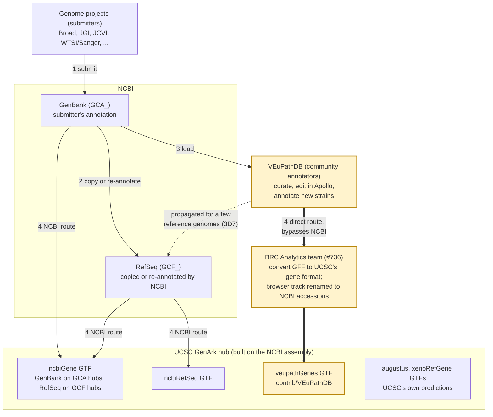

# Gene Annotation Provenance Spec

Draft, 2026-09-30. Related: #1776 (gene pages), #1777 (gene list prototype). Database design: [gene-annotation-schema.md](gene-annotation-schema.md).

## What this enables

**The gene page is the address; the value is the resolver behind it.** Any name, from any publisher, for a gene in any catalog assembly leads to one current gene, with its status and the source of every fact, and from there to workflows and, later, the knowledge graph. For reading about a single gene, v1 pages will not beat PlasmoDB or NCBI Gene; what is new is joining every name, publisher, catalog assembly and our own workflows.

**For people**

| Before                                                                                                | With gene pages                                                                                                        |
| ----------------------------------------------------------------------------------------------------- | ---------------------------------------------------------------------------------------------------------------------- |
| A workflow's results list `PVP01_0910200`, linked to nothing                                          | Each row links to its gene page, through the GTF the workflow used, matched to its annotation set version by core hash |
| An ID from a paper (`CAD24873.1`, `PF11_0344`) means a trip to NCBI or PlasmoDB, and maybe a dead end | Any name finds the current gene, or a notice that it was merged, split or retired                                      |
| "Which annotation did my analysis use?" can't be answered                                             | The annotation set version is named; the gene's change set records changes from now on                                 |
| Each publisher's view is on a separate site, under different names                                    | One page lists every publisher's names for the gene, each cited                                                        |
| Finding a catalog assembly to analyse for a gene means searching elsewhere                            | The gene page sits in its assembly, one step from a workflow with the right GTF                                        |

**For agents** (such as the BRC Analytics assistant), deterministic, typed answers instead of web searches and guesses:

| Query                                        | Answer                                                                     | Why it matters                                                              |
| -------------------------------------------- | -------------------------------------------------------------------------- | --------------------------------------------------------------------------- |
| "Resolve `PF11_0344`"                        | `PF3D7_1133400` (AMA1), current; `PF11_0344` is a previous ID per PlasmoDB | One lookup; no guessing whether old and new IDs match                       |
| "Is `PF3D7_0105400.1` still a gene?"         | Merged into `PF3D7_0105400`, declared by NCBI in `old_locus_tag`           | Status is explicit, so an agent can't describe a gene that no longer exists |
| "What does it do, and who says so?"          | Product name "apical membrane antigen 1", from PlasmoDB release 71         | Every fact carries a source to cite                                         |
| "Are these two IDs the same gene?"           | Yes, by shared locus tag, evidence `declared`                              | A link labelled with how sure it is                                         |
| "Run RNA-seq on the assembly with this gene" | Assembly, GTF and matching annotation set version                          | From a gene straight to a correctly configured workflow                     |
| "What else is known about it?"               | NCBI GeneID `810891`                                                       | The join key into NCBI Gene, orthologs and the knowledge graph              |

**Not in v1:** function beyond the product name, expression, orthologs and cross-species comparison; predictions (55% of catalog assemblies); and VEuPathDB records until the VEuPathDB-to-UCSC conversion (#736) publishes full annotation files.

## Data challenges

- **Many sources for one assembly's genes:** NCBI RefSeq, the GenBank submitter, VEuPathDB, and UCSC's mirrors of each, plus UCSC's own predictions.
- **Files change under the same name:** NCBI overwrites GFF3s in place, even within a release label. UCSC appears to keep one unversioned GTF per track.
- **Release labels are missing or inconsistent:** none of the 2,031 UCSC `ncbiGene` tracks has one. Elsewhere they read "release 68", `RS_2026_09` or "INSDC submitter (2023-10-05)".
- **Mirrors lag:** 321 of the 2,419 catalog UCSC `ncbiGene` and `ncbiRefSeq` GTFs (13%) were built before NCBI last changed the annotation's locations, a median of 179 days before; 306 of the 321 are bacteria (#1874, GenArk GTFs behind NCBI's annotation; checked 2026-10-15).
- **How much the copies differ** (UCSC `ncbiGene` GTF vs NCBI's current GFF3, protein-coding genes by coding coordinates; 500 more assemblies, 2026-10-14): 76% identical. Eukaryotes: 15 of 239 differ, median 0.2% of genes. Bacteria differ almost always: 80 of 80 where UCSC is behind NCBI (median 2.4% of genes, up to 5%), and 18 of 19 where it isn't (median 1.3%). Viruses: 6 of 160.
- **Gene IDs differ between copies; same-name genes are merged:** UCSC's GTF converter (`genePredToGtf`) writes the gene symbol as `gene_id` when there is one, else the locus tag. It makes repeated transcript IDs unique (`_2`) but not gene IDs, so separate genes sharing a symbol become one `gene_id`. In _Rickettsia helvetica_ (`GCF_963970025.1`), NCBI's two `lpdA` genes (`AB1146_RS01845`, `AB1146_RS07020`, 870 kb apart) are one `gene_id` "lpdA", and likewise `def` and `gltX`. The BRC RNA-seq workflows (v1.4) count by `gene_id` (STAR GeneCounts, featureCounts), so reads from both genes land in one row. Measured on 1,059 `ncbiGene` and 80 `ncbiRefSeq` GTFs (2026-10-15): merges in 207 of 211 bacteria (median 0.95% of genes, max 6%; not related to UCSC lag), 9 of 331 viruses (herpes simplex, mpox, HHV-6/7 repeat-copy genes), 31 of 515 eukaryotes on `ncbiGene` (mostly under 1.5%, but _Toxocara canis_ 16%, mostly coding genes) and 23 of 80 on `ncbiRefSeq` (mostly tRNA genes, up to 21% of genes in ticks). NCBI's own GTF keeps every one of these merges apart. Curated genomes (_E. coli_ K-12, _M. tuberculosis_ H37Rv) have unique symbols and no merges. Where UCSC's copy is up to date, the remaining eukaryotic differences are mostly **partial genes** (coding sequence running off a contig end; 370 in the 500-assembly sample, 326 in one microsporidian); how UCSC converts those is not yet checked.
- **Copies are thinner:** UCSC GTFs have no products, biotypes or cross-references. In _P. vivax_ P01 (`GCA_900093555.2`), UCSC also splits multi-exon genes into single-exon transcripts.
- **GenBank lacks what RefSeq adds:** 3D7's GenBank annotation has no gene symbols and no NCBI GeneIDs; its RefSeq annotation has 2,152 symbols and a GeneID on every gene.
- **RefSeq can arrive years after the paper:** labs submit only to GenBank (or ENA or DDBJ), and NCBI builds RefSeq later, if at all. _E. cuniculi_'s genome paper is from 2001; its RefSeq annotation, with new `NM_` and `NP_` accessions, is dated 2022-12-22. So the IDs a paper cites and NCBI's current IDs often differ.
- **Sequence names differ by source:** the same 3D7 chromosome is `Pf3D7_03_v3` in PlasmoDB and `AL844502.2` in GenBank.
- **Old IDs from papers aren't in NCBI:** pre-2012 _P. falciparum_ IDs (AMA1 was `PF11_0344`, now `PF3D7_1133400`) survive only in PlasmoDB's history.
- **Predictions renumber:** augustus IDs (`g1`, `g2`…) change on every rerun.

## Background: how gene annotation reaches us



The highlighted path, with thick arrows, is how VEuPathDB's annotation reaches UCSC without going through NCBI. Numbers match the steps below.

1. **Genome projects submit.** The group that sequenced a genome (Broad, JGI, JCVI, WTSI/Sanger and others) submits its assembly and annotation to GenBank. NCBI lists that group as the annotation's provider. GenBank, ENA and DDBJ form one shared archive (the INSDC) and exchange records under the same accessions, so NCBI's GenBank annotation covers submissions to all three; ENA is not a separate publisher. European groups usually submit through ENA, which is why P01 (WTSI) and _E. cuniculi_ (Genoscope) carry ENA-style protein accessions (`VVA00402.1`, `CAD24873.1`).
2. **NCBI RefSeq copies or re-annotates.** RefSeq builds a curated copy of the assembly (`GCF_`). Its annotation is a copy of the submitter's ("INSDC submitter" on 275 of 390 UCSC RefSeq tracks), a re-annotation by NCBI's own pipeline (prokaryotes get new `_RS` locus tags), or, for a few reference genomes, VEuPathDB's annotation propagated into RefSeq (3D7's is labelled "Community Annotation").
3. **VEuPathDB annotates as a community resource.** It loads the submitter's annotation, then curators and researchers improve it, partly through the Apollo editor, and it annotates some assemblies that came with none (the Dd2 batch of _P. falciparum_ strains). These improvements mostly do not go back to GenBank. Of the 438 catalog assemblies with VEuPathDB annotation, 386 also have NCBI annotation, often the submitter's older version, and 52 have only VEuPathDB's.
4. **UCSC mirrors.** Each GenArk hub is built from an NCBI assembly. Its `ncbiGene` and `ncbiRefSeq` GTFs come from NCBI: `ncbiGene` is GenBank's annotation on a GCA hub and RefSeq's on a GCF hub (1,026 and 1,005 of the catalog's 2,031). Because NCBI lacks VEuPathDB's annotation, UCSC takes it from VEuPathDB directly as a contributed track (`contrib/VEuPathDB/veupathGenes.bb`, "Gene Models mirrored from VEuPathDB"). BRC Analytics arranged this in #736, mapping VEuPathDB sequence names to NCBI accessions for the browser track, and in #859, so workflows could use the GTF. #736 also plans to load Apollo community annotations. UCSC adds its own predictions (augustus, xenoRefGene) to every hub. The purpose was workflows and the genome browser: a UCSC GTF keeps the genome locations, exons, CDS and gene IDs workflows need, on the sequence names of the genome they align to. The exception is the `veupathGenes` GTF, which keeps VEuPathDB's sequence names in 415 of 438 hubs (#1830, VEuPathDB GTF sequence names). The conversion to UCSC's formats drops product names, previous IDs and cross-references, which matter only for gene pages.
5. **BRC Analytics reads both.** Gene pages are read from the publishers' own annotation files (GenBank, RefSeq, VEuPathDB); workflows run on UCSC's GTF copies.

### Routes into a UCSC GTF

Every annotation file reached us by one of these routes. The `route` value is what an annotation set version records (see Provenance records). Counts are catalog assemblies.

| #   | `route`                  | Path                                                                   | UCSC GTF                   | Label you'd see (`dataVersion` or GFF3 header)      | Example                                         | Count                                       |
| --- | ------------------------ | ---------------------------------------------------------------------- | -------------------------- | --------------------------------------------------- | ----------------------------------------------- | ------------------------------------------- |
| 1   | `genbank_submitter`      | Lab annotates → GenBank → UCSC                                         | `ncbiGene`                 | none                                                | P01: "Annotation submitted by WTSI"             | 1,026 `ncbiGene` hubs on GCA                |
| 2   | `refseq_copy`            | Lab annotates → GenBank → RefSeq copies it → UCSC                      | `ncbiRefSeq`               | "INSDC submitter (date)"                            | 3D7's current UCSC track                        | 275                                         |
| 3   | `refseq_ncbi_prokaryote` | Lab submits assembly → RefSeq re-annotates with NCBI's pipeline → UCSC | `ncbiRefSeq` or `ncbiGene` | "NCBI RefSeq `GCF_…-RS_<date>`"; `_RS` locus tags   | _Yersinia pestis_ `RS_2026_04_06`               | 28 `ncbiRefSeq`, plus 400 `ncbiGene` on GCF |
| 4   | `refseq_ncbi_eukaryote`  | Lab submits assembly → NCBI annotates the eukaryote itself → UCSC      | `ncbiRefSeq`               | "NCBI _Species_ Annotation Release N"               | _Aedes albopictus_ Release 101                  | 4                                           |
| 5   | `refseq_from_veupath`    | Lab → GenBank → VEuPathDB curates → RefSeq propagates it → UCSC        | `ncbiRefSeq`               | GFF3 `#!annotation-source Community Annotation …`   | 3D7 `RS_2026_09` (not yet at UCSC)              | few; 3D7 known                              |
| 6   | `veupath_curated`        | Lab → GenBank → VEuPathDB curates → UCSC directly (#736)               | `veupathGenes`             | "VEuPathDB release 68"                              | _Aspergillus flavus_                            | most of 386                                 |
| 7   | `veupath_annotated`      | Lab submits assembly only → VEuPathDB annotates → UCSC directly        | `veupathGenes`             | "VEuPathDB release 68"                              | Dd2 and 14 other Sanger _P. falciparum_ strains | within the 52 VEuPathDB-only                |
| 8   | `refseq_from_mod`        | Model-organism database → RefSeq → UCSC                                | `ncbiRefSeq`               | "FlyBase Release 6.54", "PomBase", "WormBase WS297" | _Drosophila_                                    | 3                                           |
| 9   | `ensembl`                | Ensembl → UCSC                                                         | `ensGene`                  | none; year and month in column 2                    | _Cimex lectularius_                             | 15                                          |
| 10  | `ucsc_augustus`          | UCSC predicts from the assembly alone                                  | `augustus`                 | none                                                | every hub                                       | 4,475                                       |
| 11  | `ucsc_xenorefgene`       | UCSC maps other species' RefSeq mRNAs onto the assembly                | `xenoRefGene`              | none                                                | every hub                                       | 4,480                                       |

Routes 9–11 are outside the v1 publishers. Not tallied here, so there may be more routes: about 60 of the 390 `ncbiRefSeq` tracks, whose labels don't fit a row, and the 605 viral RefSeq `ncbiGene` tracks on GCF hubs. Route 3's 400 `ncbiGene` tracks are the GCF bacteria and archaea. Route 5's count is unchecked.

## Problem

BRC Analytics is not the source of truth for any gene. Every gene we show comes from someone else's annotation release, and that release will change. A pull today and a pull next month can return different genes, IDs and gene models for the same assembly.

**Every gene can be found; only its latest version has a page.** This covers every gene that has ever appeared in any annotation file for a catalog assembly. Old names and names from other systems all lead to the latest information. We don't show old versions of gene pages: reproducing an old analysis is served by the archived annotation file and its annotation set version ID.

### What we know about every gene

| Question                                           | Example (AMA1 in 3D7)                                                  |
| -------------------------------------------------- | ---------------------------------------------------------------------- |
| **1. What is it called?** One canonical ID         | `PF3D7_1133400`                                                        |
| **2. Aliases:** its current names in other systems | `AMA1`, NCBI GeneID `810891`, RefSeq transcript and protein accessions |
| **3. Previous names**, in this and other systems   | `PF11_0344`                                                            |
| **4. Status**                                      | current                                                                |

The canonical ID comes from the first publisher in this order that has the gene: VEuPathDB gene ID, then NCBI locus tag (RefSeq, then GenBank). In practice the first two are usually the same string. Other publishers' IDs become aliases or, like GenBank's `CWE02_00005` for RefSeq's `CWE02_RS00005`, previous names.

**Links between names.** A link says two names belong to the same gene, or that one replaced the other. In v1, links come only from what publishers declare:

| Link type             | Stated by                                         | Example                                                                                                     |
| --------------------- | ------------------------------------------------- | ----------------------------------------------------------------------------------------------------------- |
| `shared_locus_tag`    | Any two publishers' files on the same assembly    | `PF3D7_1133400` in GenBank, RefSeq and PlasmoDB                                                             |
| `old_locus_tag`       | NCBI, in the GFF3                                 | RefSeq `CWE02_RS00005` ← `CWE02_00005`; `PF3D7_0105400` ← `.1`, `.2` (a merge)                              |
| `gene_history`        | NCBI Gene                                         | A discontinued GeneID and the GeneID that replaced it                                                       |
| `veupath_previous_id` | VEuPathDB                                         | `PF11_0344` → `PF3D7_1133400`                                                                               |
| `same_accession`      | NCBI, in the GFF3 (`transcript_id`, `protein_id`) | An `XM_` accession that moves to a new locus tag between releases: the same transcript under a new gene ID  |
| `orig_transcript_id`  | NCBI RefSeq, in the GFF3                          | RefSeq `XM_001347979.2` ← GenBank submitter's `PF3D7_1133400.1` (`gnl\|ASM:GCA_000002765\|PF3D7_1133400.1`) |

The same publisher gene ID in two releases needs no link: it is one publisher gene, keyed on annotation set + publisher gene ID (see the schema). A shared locus tag links records only on the same assembly; a GCA and a GCF count as one only when NCBI pairs them as identical. Matching symbols, UCSC `gene_id`s and overlapping coordinates are not links in v1.

`same_accession` and `orig_transcript_id` link transcripts; the gene-level link follows each transcript's `Parent`. An accession (`XM_001347979`) names one sequence record and is never reused; its version goes up when the sequence changes, not when metadata does. So a `same_accession` link is made only when one accession, version ignored, sits under two different publisher gene IDs. Under the same ID it is the same publisher gene, and a new version (`XM_001347979.1` → `.2`) is recorded on its transcript record and shows the gene model changed. Limits: these are mostly RefSeq (GenBank annotations carry versioned protein accessions only; GTFs, VEuPathDB and predictions have none), and an accession NCBI suppresses just disappears, leaving `gene_history` and `old_locus_tag` to cover it. Accessions sit on transcripts and proteins because NCBI versions sequences; a gene has a GeneID in NCBI Gene but no version.

Every link records its **source** (link type, the publisher that stated it, and the annotation set version it came from) and its **evidence**: `declared` for all v1 links. Inferred links come later (see Deferred) with evidence `inferred` and the name of the rule that made them, so pages can tell "previous ID (per PlasmoDB)" from "probably the same gene (inferred)".

**Status:**

| Status      | What finding the gene shows                                                                     | Example                                                         |
| ----------- | ----------------------------------------------------------------------------------------------- | --------------------------------------------------------------- |
| **Current** | Its gene page                                                                                   | `PF3D7_1133400`                                                 |
| **Retired** | A short notice, e.g. "Retired: not in RefSeq since `RS_2026_09`"                                | A gene a new release drops                                      |
| **Merged**  | The page of the gene it merged into. Its ID becomes a previous name of that gene                | 3D7's `PF3D7_0105400.1` and `.2` → `PF3D7_0105400` (per RefSeq) |
| **Split**   | A short notice, "This gene was split into", linking to the current pages of the genes it became | A declared one-to-many replacement in NCBI's `gene_history`     |

**Going forward, a change set per gene.** Each refresh can record what changed for each gene (a new symbol, a moved exon, a merge), so a gene's changes over time can be shown later. This works only from when we start recording: past states mostly can't be rebuilt, because NCBI overwrites its files in place.

In the change set, a new protein accession version (`XP_001348015.1` → `.2`) means the gene model changed: the protein is different. A new mRNA accession version with the same protein version means a smaller change, such as a UTR or an untranslated exon boundary.

### Predictions are out of v1

UCSC's predicted genes (augustus, and xenoRefGene genes mapped from other species' RefSeq) get no gene pages and are not in gene search in v1. This leaves about 3,026 of the 5,506 catalog assemblies (55%) without gene pages: those with only predictions at UCSC and no NCBI or VEuPathDB annotation, plus 3 with no GTF at all (UCSC `genArkFileList.txt.gz` and NCBI, 2026-10-02). We accept that:

- **Their IDs aren't names.** augustus IDs are counters (`g1`, `g2`…) that mean something only within one assembly and one run, and every rerun renumbers them. A canonical name would have to be something like `<assembly>.<run>.g2`, which nobody would search for.
- **None of the four questions can be answered.** There are no aliases or previous names, and no publisher declares links between runs, so we can't tell whether a prediction was retired, merged or split.
- **A page would be little more than coordinates.** The GTF gives genome location, exon and CDS structure, and which run it came from. A predicted protein and a UCSC link take a little more work. Everything else (domains, similar proteins, orthologs, GO terms, xenoRefGene's source gene) would be our own inference.
- **Nothing outside our own analysis results points at them.** They can be found only by genome location, by sequence similarity, or from a results table made with that exact GTF.
- **Workflows are unaffected.** They keep using UCSC's prediction GTFs as they do today.

They come back as the future use case "Look up a gene from my analysis results", with each page scoped to one annotation set version (`g1234` in one augustus run).

### Current use cases (v1)

| Use case                                    | Example                                                            | What it needs                                                                                                                                               |
| ------------------------------------------- | ------------------------------------------------------------------ | ----------------------------------------------------------------------------------------------------------------------------------------------------------- |
| **Tell me about a gene**                    | "Tell me about `abd` in nasty-pox"                                 | One page from the latest annotation: what the gene is believed to do, where it is, and a link to the publisher's own page                                   |
| **An old ID finds the current gene**        | A paper names `abc`, which the publisher has since renamed `abd`   | Previous IDs from the publisher's own history, resolving to `abd`'s page with a note. For pre-2012 _P. falciparum_ IDs, see Open questions                  |
| **What annotation did my analysis use?**    | A reviewer asks which annotation the RNA-seq counts were made with | An annotation set version ID (`<annotation_set_uid>@<version>`) that exports carry and a workflow can record, and our archived copy of that annotation file |
| **Why does BRC differ from the publisher?** | BRC shows PlasmoDB release 68 while PlasmoDB itself is on 71       | A provenance line on each gene page, plus the publisher's latest release label                                                                              |

### Future use cases

| Use case                                            | Example                                                          | What it needs                                                                                                                        | Depends on                                                                                                                                        |
| --------------------------------------------------- | ---------------------------------------------------------------- | ------------------------------------------------------------------------------------------------------------------------------------ | ------------------------------------------------------------------------------------------------------------------------------------------------- |
| **How does this gene relate to what else we know?** | "How does `abd` relate to the knowledge graph?"                  | The gene's current ID (likely its NCBI GeneID) as the join key into function, orthologs and the graph                                | The knowledge graph and its identifier mapping                                                                                                    |
| **What changed in this gene over time?**            | "Has `abd` changed since the release my analysis used?"          | The per-gene change set, recorded at each refresh                                                                                    | Recording change sets from now on. Past VEuPathDB changes can be rebuilt from release 24 on (see `gene-history-findings.md`); NCBI's mostly can't |
| **Look up a gene from my analysis results**         | My RNA-seq counts on a prediction-only assembly list `g1234`     | A page per predicted gene, scoped to one annotation set version (its ID + `g1234`), reached from workflow results rather than search | Workflow results that record their annotation set version ID; see Predictions are out of v1                                                       |
| **Is there a newer annotation, and what changed?**  | I ran RNA-seq on release 68; is 71 out, and did my genes change? | Per-annotation-set change counts ("68 → 71: 12 modified, 9 new, 3 retired") and per-gene status for a gene list                      | Storing the refresh report (see Refresh policy). Low priority: most studies pin one annotation                                                    |
| **Tell me when my run is out of date**              | Notify me that a run used release 68 and 71 is now available     | A record of each run and its annotation set version ID                                                                               | The workflow side: BRC recording runs and the annotation set version each used                                                                    |
| **My saved genes still point at the right genes**   | A saved gene set (#990) made before a refresh                    | Links that survive merges and splits                                                                                                 | Saved gene references (#990); see Deferred                                                                                                        |

## Key terms

**Annotation records**

- **Publisher:** who asserts the genes in an annotation file: NCBI RefSeq, NCBI GenBank (the submitter's annotation) or VEuPathDB. UCSC's GTFs are copies, apart from its predictions (augustus, xenoRefGene), which are out of v1.
- **Annotation set:** one publisher's annotation for one assembly, across all its releases (e.g. VEuPathDB's annotation of `GCA_900632045.1`).
- **Annotation set version:** one state of the publisher's annotation content, as its release label, core hash and content hash measure it. A new release label makes a new annotation set version, and so do changed genes under the same label. A file rewritten with the same content, or a UCSC copy made or rebuilt, does not. Each entity has a UUID and numbered versions (see [gene-annotation-schema.md](gene-annotation-schema.md)).
- **Annotation file:** one GFF3 or GTF of an annotation set version. The **original** is the publisher's own; a **copy** is a mirror such as UCSC's GTF.
- **GenBank flat file (`.gbff`):** NCBI's native text format, one record per sequence: a header of descriptors (organism, publications, dates), a feature table (genes, mRNAs and CDS with locus tag, product, protein accession and translation), and the DNA sequence. NCBI publishes one next to each GFF3, generated from the same records. It carries the same genes plus the descriptors and sequence GFF3 leaves out, so a descriptors-only change rewrites the `.gbff` and leaves the GFF3 alone (P01, 2024-02-13). Not read in v1, and not an annotation file in this spec's sense.
- **Release label:** the publisher's own version name, e.g. "release 68" or `RS_2026_09`.
- **Gene record:** what one annotation set version says about one gene (see Gene identity). Stored only when it changes from the publisher's previous version (see the schema).
- **Canonical record:** of a gene's records, the one from the publisher that comes first in the precedence order. It supplies the gene's genome location, gene model and product name on the page.
- **Provenance line:** a line under the gene name on its page listing every annotation set version with a record in the gene, e.g. "From PlasmoDB release 71 and NCBI RefSeq `RS_2026_09`".
- **Retired gene:** a gene no current record belongs to: every publisher that had it has dropped it from its newest annotation set version.
- **UCSC work queue:** a report page on the site, built from the `ucsc_work_queue` projection (see the schema). It lists assemblies where UCSC has no copy of a publisher's current annotation, or a copy that doesn't match it.

**Gene structure**

- **Genome location:** where a gene sits on the assembly: sequence name, start, end and strand, e.g. `NC_037282.1:1,292,966–1,296,696 (+)`.
- **Gene model:** the publisher's description of a gene's structure: its transcripts, exons and CDS.
- **Transcript:** one RNA made from a gene. A gene can have several, differing in which exons they keep. In a GFF3, an `mRNA` line and its `exon` lines describe the mature mRNA: spliced, exons only, UTRs included where known. This is the molecule a RefSeq `XM_`/`NM_` accession names, and the one the ribosome reads.
- **Accession prefixes:** `XM_`/`XP_` are computed mRNA and protein models (AMA1's are `XM_`); `NM_`/`NP_` are curated by NCBI staff, common for human and rare for parasites.
- **Exon / intron:** exons are the pieces of a gene kept in the mature RNA; introns are the pieces spliced out between them.
- **UTR (untranslated region):** the ends of the first and last exons that are in the RNA but not translated into protein. Often missing or different between annotations.
- **CDS (coding sequence):** the part of the exons that is translated into protein, from start codon to stop codon. Each `CDS` line in a GFF3 or GTF gives one coding piece, usually one per exon.
- **Pseudogene:** a broken copy of a gene that no longer makes a working protein. Publishers differ on whether to give one `CDS` lines.

**Sequences**

- **Coordinate system:** the sequence names and lengths that genome locations refer to (a genome's `chrom.sizes`). Two genomes with the same names and lengths share a coordinate system even if some bases differ.
- **Refget sequence digest:** GA4GH's identifier for one sequence, such as a chromosome or contig, computed from its bases alone (Refget Sequences v2.0, approved 2024). Strip everything but letters, uppercase them, take the SHA-512, keep the first 24 bytes, base64url-encode them and prefix `SQ.`. The MD5 of the same letters is also accepted. The same bases give the same digest whatever the sequence is called: `CM003407` and `AODS02000001.1` either share a digest or are different sequences.
- **Sequence collection (seqcol) digest:** GA4GH's identifier for a whole genome, computed from its sequences' names, lengths and refget digests (Sequence Collections v1.0, approved 2025). Names and sequences decide the digest, so the same bases under different names give a different seqcol digest. Seqcol's comparison reports which part differs: names, lengths, sequences or order. Its `name_length_pairs` attribute is the genome's coordinate system on its own.

**Gene identifiers and descriptions**

| Term                  | Example                     | Minted by, and when                                                                                                                                                                  | Stability                                                                     |
| --------------------- | --------------------------- | ------------------------------------------------------------------------------------------------------------------------------------------------------------------------------------ | ----------------------------------------------------------------------------- |
| **Locus tag**         | `PF3D7_1133400`             | The genome submitter, when it first submits annotation, using a prefix registered with NCBI for its project (`PF3D7`, `PVP01`). NCBI's prokaryote pipeline mints its own (see below) | Meant to stay with the gene for the life of the assembly; unique within it    |
| **Old locus tag**     | `CWE02_00005`               | Not minted: a GFF3 attribute (`old_locus_tag`) where a publisher records a locus tag it replaced                                                                                     | Historical; only as complete as the publisher made it                         |
| **NCBI GeneID**       | `810891`                    | NCBI Gene, when a gene first appears in a RefSeq annotation. GenBank submitter annotation has none                                                                                   | Stable; a retired or merged GeneID is listed in `gene_history`                |
| **Gene symbol**       | `AMA1`                      | Curators or the research community, at any time; carried by whichever publisher adopts it                                                                                            | Not unique and can change; an attribute, never an identity                    |
| **Product name**      | "apical membrane antigen 1" | The annotator (submitter, NCBI pipeline or VEuPathDB curators), with each release; often "hypothetical protein"                                                                      | Changes freely between releases                                               |
| **VEuPathDB gene ID** | `PF3D7_1133400`             | VEuPathDB, when it loads a genome; usually the locus tag                                                                                                                             | Stable within VEuPathDB; renames are listed as previous IDs on its gene pages |

## How publishers share gene IDs

The locus tag is the one ID that every publisher of an assembly can carry:

- **GenBank** has the submitter's locus tags and products, but no gene symbols or GeneIDs. In 3D7 (`GCA_000002765.3`): 5,387 protein-coding genes, 0 symbols, 0 GeneIDs.
- **RefSeq, eukaryotes:** keeps the submitter's locus tags and adds a GeneID to every gene, plus symbols where it has them. In 3D7 (`GCF_000002765.6`): 5,285 protein-coding genes, 2,152 symbols, all with GeneIDs; 5,353 locus tags are in both GenBank and RefSeq. 3D7 is a best case, because its RefSeq is PlasmoDB's community annotation; 275 of 390 UCSC RefSeq tracks are labelled "INSDC submitter", copies of the GenBank annotation, which likely add GeneIDs but few symbols (not checked).
- **RefSeq, prokaryotes:** NCBI's pipeline re-annotates and mints new locus tags with `_RS`, keeping the submitter's in `old_locus_tag`. In _Brucella pituitosa_ (`GCF_002803535.1`), 4,437 of 4,526 genes have one, e.g. `CWE02_RS00005` ← `CWE02_00005`.
- **VEuPathDB:** gene IDs usually equal the locus tag.

**The old locus tag story.** `old_locus_tag` is the only machine-readable rename history NCBI puts in the GFF3, and how complete it is depends on the publisher:

- In prokaryote RefSeq it links almost every gene back to its GenBank locus tag, as above.
- In 3D7's RefSeq, 100 of 5,453 genes have one, and all are versioned forms of the current tag (`PF3D7_0105400.1`).
- The 2012 _P. falciparum_ renaming (AMA1 `PF11_0344` → `PF3D7_1133400`) is not in NCBI at all. Only PlasmoDB lists those previous IDs.

### What an NCBI GFF3 holds

NCBI describes its GFF3 format ([About NCBI GFF3](https://www.ncbi.nlm.nih.gov/datasets/docs/v2/reference-docs/file-formats/annotation-files/about-ncbi-gff3/)) but publishes no schema of what a file is guaranteed to hold. Column-9 attributes come from the INSDC feature table qualifiers ([INSDC Feature Table Definition](https://www.insdc.org/submitting-standards/feature-table/)): `gene` from `/gene`, `Dbxref` from `/db_xref`, `product`, `locus_tag`, `old_locus_tag`, `gene_synonym`, and so on. Every qualifier is optional, and NCBI says a file reflects its source GenBank or RefSeq record, so what it holds depends on the submitter. NCBI also says protein-coding genes in prokaryotes, organelles and some eukaryotes have no mRNA features, in INSDC or RefSeq; P01 is one of those eukaryotes.

**Sample, 2026-10-23.** One NCBI-annotated catalog assembly per taxonomic group and source (reference assemblies first), plus P01 and _F. graminearum_ PH-1: 9 RefSeq, 11 GenBank. Counts are per gene (`gene` and `pseudogene` rows); a symbol is a `gene` value that is neither the locus tag nor an NCBI `LOC` placeholder.

| What the file holds                              | RefSeq (9)                                                               | GenBank (11)                                                                                                                       |
| ------------------------------------------------ | ------------------------------------------------------------------------ | ---------------------------------------------------------------------------------------------------------------------------------- |
| Protein accession and product on each CDS        | all                                                                      | all                                                                                                                                |
| NCBI GeneID                                      | all, on every gene                                                       | none                                                                                                                               |
| mRNA rows                                        | 8 of 9; not _M. tuberculosis_ (CDS on the gene)                          | 10 of 11; not P01. In _Ixodes hexagonus_ 13,810 of 19,482 CDS and in _F. graminearum_ 10,632 of 14,145 hang on the gene regardless |
| Transcript accession (`transcript_id`, `XM_…`)   | 7 of the 8 with mRNA rows; not the virus                                 | none                                                                                                                               |
| Submitter's transcript ID (`orig_transcript_id`) | 4                                                                        | 6, e.g. `gnl\|WGS:PSSZ\|BO78DRAFT_mRNA412464`                                                                                      |
| Gene symbol                                      | 6 of 9, 23–61% of genes (3D7 2,153 of 5,611; _Bos taurus_ 61%); 3 have 0 | 3 of 11, 1–5% of genes; 8 have 0                                                                                                   |
| Gene synonyms (`gene_synonym`)                   | 2 (_M. tuberculosis_ 337, _B. taurus_ 4,586)                             | none                                                                                                                               |
| Old ID (`old_locus_tag`)                         | 3: 3D7 100, _L. donovani_ 60, _Amblyomma americanum_ 37                  | 1: _F. graminearum_ 24,787, e.g. `FGRAMPH1_01T00001` ← `FGSG_11606`                                                                |

Assemblies: RefSeq `GCF_000002765.6` (_P. falciparum_ 3D7), `GCF_018416015.2` (_Coccidioides posadasii_), `GCF_000227135.1` (_Leishmania donovani_), `GCF_052857255.1` (_A. americanum_), `GCF_020800215.1` (_Phytophthora ramorum_), `GCF_000313135.1` (_Acanthamoeba castellanii_), `GCF_000195955.2` (_M. tuberculosis_ H37Rv), `GCF_000857325.3` (Marburg virus), `GCF_002263795.3` (_B. taurus_); GenBank `GCA_900093555.2` (_P. vivax_ P01), `GCA_900044135.1` (_F. graminearum_ PH-1), `GCA_003184635.1` (_Aspergillus sclerotiicarbonarius_), `GCA_964035595.1` (_Somion occarium_), `GCA_000755165.2` (_Leishmania panamensis_), `GCA_964199285.2` (_I. hexagonus_), `GCA_046563165.1` (_Acanthocheilonema viteae_), `GCA_948099385.2` (_Fasciola hepatica_), `GCA_049996435.1` (_Nucleospora cyclopteri_), `GCA_006247105.1` (_Giardia muris_), `GCA_040256725.1` (_Mucor lusitanicus_).

So from NCBI alone, every assembly gives a gene ID, protein accession and product; only RefSeq gives GeneIDs and transcript accessions; symbols and old IDs are sparse in both. P01 (GenBank) has gene IDs, protein accessions and products, and no transcripts, symbols, GeneIDs or old IDs.

### What RefSeq does to GenBank's annotation

RefSeq does one of three things with an assembly's GenBank annotation. Of the 1,394 annotated RefSeq assemblies in the catalog, the annotation provider is "NCBI RefSeq" for 1,115, a lab's name for 278, and "Community Annotation" for 1 (3D7).

| What RefSeq does                                                         | Provider                  | Example                                                          | Gene models vs GenBank                                                                                                                 |
| ------------------------------------------------------------------------ | ------------------------- | ---------------------------------------------------------------- | -------------------------------------------------------------------------------------------------------------------------------------- |
| **Copies the lab's annotation** (route `refseq_copy`)                    | The lab, e.g. "Genoscope" | _Encephalitozoon cuniculi_ `GCA_000091225.2` → `GCF_000091225.2` | Identical: 2,121 of 2,121 protein-coding genes                                                                                         |
| **Re-annotates with NCBI's pipeline** (route `refseq_ncbi_prokaryote`)   | "NCBI RefSeq"             | _Brucella pituitosa_ `GCF_002803535.1`                           | A new annotation: new `_RS` locus tags, the lab's kept in `old_locus_tag` on 4,437 of 4,526 genes. Gene model differences not measured |
| **Takes VEuPathDB's community annotation** (route `refseq_from_veupath`) | "Community Annotation"    | 3D7 `GCF_000002765.6`                                            | Same CDS for 5,183 of 5,185 shared genes; 98 declared merges; 202 GenBank genes absent                                                 |

**A RefSeq copy is mostly additive.** The same gene in _E. cuniculi_:

```
GenBank  gene  ID=gene-ECU01_0010; gene=ECU01_0010
         CDS   protein_id=CAD24873.1; product=hypothetical protein; Note=…gene found by Glimmer…
RefSeq   gene  ID=gene-ECU01_0010; locus_tag=ECU01_0010; Dbxref=GeneID:860172; partial=true
         mRNA  transcript_id=NM_001415161.1; product=uncharacterized protein
         CDS   protein_id=NP_001402090.1; Dbxref=EnsemblGenomes-Gn:CAD24873,…; Note=…gene found by Glimmer…
```

| Change                                                                                                                                                                 | Lossy?                                                         |
| ---------------------------------------------------------------------------------------------------------------------------------------------------------------------- | -------------------------------------------------------------- |
| Sequence names renamed (`AL391737.2` → `NC_003242.2`)                                                                                                                  | No: chromAlias reverses it                                     |
| Genome locations and CDS                                                                                                                                               | Unchanged                                                      |
| The lab's ID becomes a proper `locus_tag`; NCBI GeneID added (2,155 genes); mRNA lines with `NM_` accessions added (2,122; GenBank had none); partial-gene flags added | No: added                                                      |
| Notes and UniProt cross-references kept                                                                                                                                | No                                                             |
| Protein accession replaced (`CAD24873.1` → `NP_001402090.1`); GenBank's survives only as an unversioned Ensembl cross-reference                                        | Yes, slightly: the GenBank protein accession's version is gone |
| Product names standardised ("hypothetical protein" → "uncharacterized protein"; 908 in GenBank, 0 in RefSeq)                                                           | Yes: the lab's original wording is gone                        |

So both records are kept (see Gene identity): the RefSeq record adds GeneID, symbol and transcripts, and the GenBank record keeps the lab's protein accessions, with their versions, and its product wording. Researchers often hold the GenBank protein accession, from BLAST against NCBI's protein database, UniProt cross-references or papers.

## How each publisher versions annotation

Each publisher has a release label and gene IDs; NCBI also versions transcripts and proteins (`XM_001608495.1` → `.2`). Only some publishers publish a history linking one release to the next.

| Publisher                   | Release label                                                                                                      | History across releases                                                                                                                           |
| --------------------------- | ------------------------------------------------------------------------------------------------------------------ | ------------------------------------------------------------------------------------------------------------------------------------------------- |
| NCBI RefSeq (GCF\_)         | Annotation name + date, e.g. `GCF_000002765.6-RS_2026_09`, released 2026-09-18                                     | [gene_history](https://ftp.ncbi.nlm.nih.gov/gene/DATA/gene_history.gz) lists discontinued GeneIDs and their replacements; `old_locus_tag` (above) |
| GenBank submitter (GCA\_)   | Provider + date, e.g. "Annotation submitted by WTSI", 2019-08-01                                                   | No formal changelog. Usually changes when the submitter resubmits, but NCBI also changes files in place (below)                                   |
| VEuPathDB                   | Release number, e.g. release 68; the API gives each release's date                                                 | Gene pages list previous IDs, and so does `GeneAliases.txt`, per organism and release                                                             |
| UCSC GenArk mirror          | Track `dataVersion` in `hub.txt` (e.g. "VEuPathDB release 68"), where present, plus the GTF build date in column 2 | None. UCSC mirrors a snapshot                                                                                                                     |
| UCSC augustus / xenoRefGene | Hub build date only                                                                                                | None; IDs (`g1`, `g1.t1`) are renumbered on every rerun                                                                                           |

Two cases show why the release label matters:

- **Mirrors lag.** UCSC's 3D7 RefSeq track is labelled "INSDC submitter (2023-10-05)" and its GTF was built 2025-06-02. NCBI's current 3D7 RefSeq annotation is RS_2026_09, released 2026-09-18.
- **Derived annotation.** NCBI builds RS_2026_09 by propagating PlasmoDB's community annotation, so a "NCBI" gene there traces back to a VEuPathDB release. We record that as its route, `refseq_from_veupath` (see Routes into a UCSC GTF).

### Files change under the same name

| Publisher | What happens                                                           | Evidence                                                                                                                                                      |
| --------- | ---------------------------------------------------------------------- | ------------------------------------------------------------------------------------------------------------------------------------------------------------- |
| NCBI      | Overwrites files in place, including between and within release labels | Observed: 3D7's folder was rewritten for `RS_2026_09`; P01's genes changed in 2020 under a 2019 label, and its GFF3 was rewritten in 2021 with no gene change |
| UCSC      | Keeps one unversioned file per track, so a rebuild replaces it         | Inferred: no hub has more than one file per track, and the build date is only inside the file                                                                 |
| VEuPathDB | Numbers its releases                                                   | Not checked whether files change within a release                                                                                                             |

A change may touch genes and locations, or only metadata. NCBI's per-assembly `annotation_hashes.txt` says which, with separate hashes and dates for descriptors (organism info, publications, dates), features, locations and protein names. NCBI's README warns that the descriptors hash is currently unstable because of a bug, so we watch only features and locations. For other publishers we use our own hashes (see Hashes per annotation file).

## Sequence names

Sequence names belong to the assembly version, not the annotation release: releases 68 and 71 of Dd2 both sit on `LR131303.1`. Each annotation file uses one naming system, and each UCSC hub has one `chromAlias.txt` per assembly that maps between them, one column per system:

```
refseq         assembly   genbank      plasmoDB       ucsc
NC_000521.4    3          AL844502.2   Pf3D7_03_v3    NC_000521v4
```

Columns vary by hub: refseq, genbank, assembly (submitter name), ncbi and ucsc, plus publisher columns such as VEuPathDB, plasmoDB and ensembl when UCSC has mapped them. The 3D7 hub has a plasmoDB column even though it has no `veupathGenes` track, so PlasmoDB's own 3D7 GFF3 can be mapped.

To use or compare an annotation file, we rename column 1 to the hub's own names (GenBank for GCA, RefSeq for GCF), then check that every sequence's length matches the hub's `chrom.sizes.txt`. Matching lengths show the GFF3 or GTF was built on this assembly version; names alone don't. An annotation file whose naming has no chromAlias column, or whose lengths don't match, can't be used until we have another mapping.

**These checks follow the GA4GH refget standards** (Refget Sequences and Sequence Collections; see Key terms):

- **Annotation files are checked by coordinate system, or by bases when the publisher gives its genome.** A GFF3 or GTF carries sequence names but no bases. The check above needs only names and lengths: after renaming, every sequence it uses must appear in the hub genome with the same length. That is seqcol's coordinate-system check, done with `name_length_pairs`. When the publisher also publishes the genome FASTA its annotation is built on, as VEuPathDB does each release, compare digests instead: each renamed sequence must have the same bases as the hub sequence it maps to. That is how the VEuPathDB column of chromAlias was checked for all 438 hubs with a `veupathGenes` track (2026-10-24). Lengths are the fallback for publishers that give no FASTA.
- **Genomes are compared by sequence digest.** Two copies of a genome, such as the UCSC hub's FASTA and the FASTA a Galaxy index was built from, hold the same bases exactly when their refget digests match, sequence by sequence. Lengths can match while bases differ; digests can't. A rebuilt `.2bit` or FASTA with the same bases keeps the same digests, so a changed file alone isn't a changed genome.
- **UCSC's copy turns ambiguity codes into `N`, so compare it after doing the same.** NCBI's FASTA can hold IUPAC ambiguity codes (`Y` = C or T, `R` = A or G, …); UCSC's `.2bit` stores only A, C, G, T and N, so the hub's FASTA has `N` there. Lengths and coordinates are unchanged, but the digests differ: _P. cactorum_ `GCA_003287315.1` has 2,065 codes, and 466 of its 4,623 hub sequences don't match NCBI's (2026-10-24). Fingerprint NCBI's FASTA, or map ambiguity codes to `N` on both sides before comparing with UCSC's. The loss doesn't matter to the workflows, which only ever see UCSC's copy: BWA, bowtie2, STAR, HISAT2, minimap2, FreeBayes and bcftools gave identical results on both versions; LoFreq made junk calls only at the codes; gffread left a few resolvable amino acids as `X`.
- **Each annotation file records the genome it was checked against**, as that genome's seqcol digest. Its coordinates then point at exact bases, not at an accession or a FASTA that could be rebuilt.

## Hashes per annotation file

Publishers overwrite GFF3 and GTF files under the same name, and a change may touch genes or only other data. So every annotation file we read gets three hashes, computed the same way for both formats:

- **Core hash:** the sha256 of every CDS interval, with no gene grouping. Per sequence name (after renaming; see Sequence names) and strand, all CDS intervals are merged into sorted, non-overlapping intervals, and the hash covers that list. GTF's separate `stop_codon` lines are added back, because GFF3 includes the stop codon in the CDS. With no grouping, the hash doesn't depend on how a file groups CDS into transcripts or genes, so it matches across sources that label genes differently. Gene IDs are left out, because a UCSC GTF's `gene_id` isn't always the publisher's ID: UCSC uses the gene symbol where there is one (`lpdA`, or a submitter's own `6PGD_1`), never makes it unique, and uses bare names for viruses (`F`, `G`). IDs are compared separately. The cost: CDS of two genes that overlap on one strand become one interval, in both files alike.
- **Gene core hash:** the same CDS intervals grouped into genes: the sha256 of one key per protein-coding gene (sequence name, strand and its merged CDS intervals), sorted, still without IDs. A gene is protein-coding if it has a CDS, since GTFs carry no biotype; in a GTF a gene is a `gene_id`. It differs from the publisher's when a file groups the same CDS into different genes, as UCSC's same-name merging does (see Data challenges). Within one source it adds little, since gene IDs are in the content hash; its job is comparing a copy with its original.
- **Content hash:** everything else we read: exon and UTR coordinates for every transcript, non-coding genes (tRNA, rRNA, ncRNA, pseudogenes) and their locations, gene IDs, symbols, biotypes, products and cross-references. Introns are the gaps between a transcript's exons, so they're covered too. Computed from parsed values, so reordering attributes or changing formatting doesn't change it.

| Core    | Gene core | Content | Meaning                                                                                                                 |
| ------- | --------- | ------- | ----------------------------------------------------------------------------------------------------------------------- |
| same    | same      | same    | Equivalent GFF3/GTFs                                                                                                    |
| same    | same      | differs | Same protein-coding genes and CDS, other data changed. Counts can still differ (caveat 3)                               |
| same    | differs   | —       | Same CDS, grouped into different genes, e.g. UCSC's same-name merging. Gene-level counts differ for the regrouped genes |
| differs | —         | —       | Genes or locations changed                                                                                              |

**Example:** NCBI last changed P01's genes on 2020-06-17 (features and locations, per `annotation_hashes.txt`; `protein.faa` was written that day). It has since rewritten the GFF3 (2021-09-26), the GTF (2024-07-12) and the `.gbff` (2024-02-13, a descriptors change) without touching them. Each rewrite changes the `sha256`; the core hash and NCBI's locations hash stay the same, so a workflow run on any of these GFF3s gives the same gene-level results. NCBI's GFF3 and UCSC's GTF for P01 have the same core hash and gene core hash, across all 6,683 protein-coding genes.

Caveats:

1. **Hashes show _different_, not _newer_.** Which GFF3 or GTF is newer still comes from release labels or dates.
2. **Core hash compares across sources; content hash only within one.** A UCSC GTF and the publisher's GFF3 can match on core hash, because both carry the same protein-coding genes and locations. They never match on content hash, because UCSC's GTFs drop biotypes, products and cross-references. So content hash compares a GFF3 or GTF only with its own earlier versions.
3. **The same core hash means the same protein-coding genes and CDS, not the same RNA-seq counts.** Gene-level counts use reads on all exons, UTRs included, and the core hash leaves UTRs out. AMA1's UTRs are about half its mRNA (890 + 972 of 3,731 bases), so two GTFs with the same core hash but different UTRs can give different counts. For v1 we make only the narrower claim. Adding exons to the core hash would make "same core hash" mean "same counts", but copies without UTRs would then stop matching; how often exons differ when the CDS matches is an open question. Within one source, a UTR change still shows: exons are in the content hash, so a new GFF3 with the same CDS but different UTRs gets a new content hash and a new annotation set version. Transcript-level results can differ even when exons match: P01's UCSC GTF splits multi-exon genes into single-exon transcripts (`PVP01_0910200` becomes 5) and still matches NCBI's GFF3 on core hash.
4. **"Has a CDS" counts some pseudogenes as protein-coding.** GenBank's 3D7 GFF3 (`GCA_000002765.3`) gives 158 pseudogenes `CDS` lines, such as `PF3D7_0100500`; RefSeq's (`GCF_000002765.6`) gives the same genes none. So the two core hashes differ although the genes are the same. For GFF3s we can exclude genes marked `pseudogene` or `pseudo=true`; GTFs carry no such mark, so whether UCSC's GTFs include these CDS is an open question.
5. **For RefSeq, accession versions are a quick, declared check.** A hash of every `transcript_id` and `protein_id` with its version shows whether NCBI changed any mRNA or protein sequence, between two NCBI GFF3s or between NCBI's GFF3 and UCSC's `ncbiRefSeq` GTF, which copies the same accessions. It doesn't replace the core hash: GenBank, VEuPathDB and most of the catalog have no versioned mRNA accessions; UCSC copies accession strings unchanged, so a conversion error still matches; and a version tracks sequence, not where it sits on the genome.

## Publishers and discovery

We read genes only from publishers' GFF3s. UCSC GTFs are linked to a publisher's annotation set version as copies, because workflows run on them; we never create an annotation set version from one. UCSC's prediction GTFs are not read for gene pages in v1 (see Predictions are out of v1).

**Trusted publishers** are listed in a config file in the repo, reviewed like code. Each entry says how to find annotation for an assembly, how to read its release label, and which formats it publishes. The starting list is NCBI RefSeq, NCBI GenBank and VEuPathDB. Others (e.g. WormBase ParaSite) are added deliberately.

**VEuPathDB's annotation comes from the #736 pipeline.** VEuPathDB's own downloads and gene-record API need an account and an API key (seen 2026-10-02); with one, every file can be read directly (2026-10-24, see Open questions). The #736 pipeline already takes VEuPathDB's annotation files, maps their sequence names to NCBI accessions and converts them for UCSC. Gene pages need it to also publish the renamed annotation files themselves, with product names, previous IDs and cross-references intact, next to the UCSC copy. Those become the VEuPathDB annotation set versions' originals; the UCSC `veupathGenes` GTF stays their copy for workflows. Until they exist, the 52 VEuPathDB-only assemblies (Dd2 among them) have no gene pages, and VEuPathDB records are missing from the 386 assemblies NCBI also annotates.

For each catalog assembly:

1. **Ask each publisher** what annotation it has and at which release. Each hit becomes an annotation set version, with the publisher's GFF3 as its original, and gets both hashes.
2. **Check the UCSC hub.** For each GTF:

| UCSC GTF                                     | What happens                                                                                          |
| -------------------------------------------- | ----------------------------------------------------------------------------------------------------- |
| Same core hash as a publisher's current GFF3 | Linked to that annotation set version as a copy, the one workflows use                                |
| Same core hash, different gene core hash     | Linked as above, and flagged "groups genes differently from the publisher" (UCSC's same-name merging) |
| Different core hash                          | Not linked. The assembly goes on the work queue, noted "UCSC is older" or "UCSC differs" (see below)  |
| None for a publisher we have                 | The assembly goes on the work queue                                                                   |
| augustus or xenoRefGene                      | Not read in v1 (see Predictions are out of v1)                                                        |

The queue note uses `dataVersion` when the track has one. Otherwise it uses the build date in column 2 of the GTF (e.g. `ncbiGene.2025-02-03`): a GTF built before the publisher's release can't contain it, so it's older. A later build date proves nothing. The column-2 date is UCSC's label, not the file's timestamp: it is sometimes later than the file's Last-Modified date (#1874, GenArk GTFs behind NCBI's annotation), so "older" errs on the side of too few.

**When UCSC overwrites a GTF**, its `sha256` changes and we recompute its core hash. If it still matches, the link stays; if not, the link is dropped and the assembly goes on the work queue.

**Sample, 2026-09-30** (`catalog/prototypes/genes/hash_compare.py`, a local prototype not in this repo, which groups a GTF's CDS by `gene_id`): 50 random assemblies with a UCSC `ncbiGene` track and their own NCBI annotation, plus P01 as a control.

| Outcome                                           | Assemblies | Example                                                                                                                                  |
| ------------------------------------------------- | ---------- | ---------------------------------------------------------------------------------------------------------------------------------------- |
| Same core hash                                    | 44         | P01. 41 also match on gene core hash; the other 3 (two _Neisseria gonorrhoeae_, _P. berghei_) are same-name merges. Gene IDs match in 30 |
| Differs; GTF built before the publisher's release | 7          | _Yersinia pestis_: NCBI re-annotated as `RS_2026_04_06`, GTF built 2025-05-06                                                            |

**Up-to-date bacteria, 2026-10-21** (same script, `--accessions`): 30 bacterial GCF assemblies whose NCBI annotation predates every UCSC build (released before 2025-02-01), including the four up-to-date controls from #1874 (GenArk GTFs behind NCBI's annotation). The gene core hash matched in 0 of 30, because every one has same-name merges. The core hash matched in 22. The other 8 have real gene differences, not merges. In _Ehrlichia chaffeensis_ (`GCF_000013145.1`), 28 genes have different starts and new protein accessions in NCBI's GFF3 (`ECH_RS00020`: `WP_006010630.1` in UCSC's GTF, `WP_410517895.1` at NCBI), although `annotation_hashes.txt` dates the locations 2025-01-09, before the GTF's `ncbiGene.2025-02-03` label. _R. helvetica_ and _E. coli_ O157:H7 (`GCF_000008865.2`) each have one NCBI gene missing from UCSC's GTF. So NCBI's dates and UCSC's column-2 label don't always reveal a lag; the core hash does.

If the "UCSC differs" part of the queue grows, comparing the GTF's core hash with our archived copies of the publisher's earlier releases would name the release UCSC has.

## Option: workflow GTFs converted from NCBI's GFF3

Proposed 2026-10-22; not decided. For assemblies with NCBI annotation, workflows would run on a GTF we convert from NCBI's GFF3, the same file gene pages read, instead of UCSC's `ncbiGene` or `ncbiRefSeq` copy. VEuPathDB (`veupathGenes`) and predictions (augustus, xenoRefGene) stay on UCSC's GTFs.

### Why

Today 2,421 catalog assemblies run their workflows on a UCSC copy of NCBI's annotation. That copy has two problems that change results:

- **It lags.** 321 (13%) were built before NCBI last changed the annotation's locations, a median of 179 days before (#1874, GenArk GTFs behind NCBI's annotation). Dates don't catch all of it: 8 of 30 bacteria that look current by date still differ from NCBI's GFF3 on core hash (see Hashes per annotation file).
- **It merges genes that share a symbol** into one `gene_id`: 98% of bacterial assemblies at about 1% of genes, some eukaryotes at up to 16–21% (#1875, UCSC same-name gene merging). Gene-level counts add the copies together, and a merged row can't link to one gene page.

NCBI's own GTF fixes both, but can't be used as it is:

- **Most of them have no exons for coding genes.** Where the annotation has no mRNA features, NCBI's GTF gives a coding gene only `CDS` and start/stop codon lines; `exon` lines exist only for RNA genes. Sample of 120 of the 2,406 NCBI GTFs (2026-10-21): no exons for coding genes in 14 of 14 bacteria, 30 of 32 RefSeq viruses and 3 of 51 GenBank eukaryotes, including P01 (`GCA_900093555.2`: 6,855 genes, 153 `exon` lines, all RNA genes) and 3D7's GenBank annotation. RefSeq eukaryotes had exons in 21 of 21. The workflows count reads on `exon` lines (STAR GeneCounts; featureCounts on `exon` rows), so these assemblies, about 1,000 of the 2,406 scaled up, would count almost nothing. UCSC's GTF for P01 has 17,755 `exon` lines, because UCSC's conversion writes one per coding region.
- **13 have no NCBI GTF**, only a GFF3 (all older RefSeq eukaryotes, e.g. _Aedes aegypti_ `GCF_000004015.4`, _Candidozyma auris_ `GCF_001189475.1`). UCSC's GTF for them is its own conversion of that GFF3.
- **2 have no NCBI files at all**: both are suppressed at NCBI, which removed the files after UCSC built its GTFs (_Echinococcus granulosus_ `GCA_000469785.1`; _Ralstonia pickettii_ `GCF_902374465.1`, which GenBank now has as `GCA_902374465.2`). They need a catalog decision, not a GTF; they are flagged on #1819 (weekly catalog drift report).

Converting NCBI's GFF3 ourselves does what UCSC's conversion does, minus the lag and the merging:

| Option                               | Current with NCBI | One `gene_id` per gene  | Exons for coding genes | Covers the 13 GFF3-only | Work for us                                    |
| ------------------------------------ | ----------------- | ----------------------- | ---------------------- | ----------------------- | ---------------------------------------------- |
| UCSC's copy (today)                  | No: 13% behind    | No                      | Yes                    | Yes                     | None                                           |
| UCSC's copy, once UCSC fixes merging | No: 13% behind    | Yes, when UCSC rebuilds | Yes                    | Yes                     | None; waits on UCSC, lag remains               |
| NCBI's GTF file                      | Yes               | Yes                     | No, for about 1,000    | No                      | Supply the md5 at launch                       |
| **Convert NCBI's GFF3 ourselves**    | Yes               | Yes                     | Yes                    | Yes                     | A converter, hosting, supply the md5 at launch |

Further gains from converting ourselves:

- **The workflow's GTF is the gene pages' annotation.** It comes from the same GFF3, at the same refresh. For NCBI annotation there's nothing to match across sources: no UCSC copy on the annotation set version, almost no work queue, and `gtf_gene_map` maps each `gene_id` to itself.
- **Each converted GTF is a fixed file.** We publish each version at its own URL and never overwrite it, so a run's URL and md5 name one file for good, unlike NCBI's and UCSC's overwritten paths.
- **It doesn't wait on anyone.** UCSC's merging and lag (#1874, #1875) and NCBI's missing exons are outside our control; the conversion works around all three now.

### What the conversion does

| GTF part                           | From NCBI's GFF3                                                                                                                                                                         |
| ---------------------------------- | ---------------------------------------------------------------------------------------------------------------------------------------------------------------------------------------- |
| Sequence names                     | Column 1 unchanged: NCBI's GFF3 already uses the hub's names (GenBank for GCA, RefSeq for GCF). Lengths checked against the hub's `chrom.sizes.txt` (see Sequence names)                 |
| `gene_id`                          | The publisher gene ID: the locus tag; where a gene has none, its NCBI GeneID (NCBI's own eukaryote annotations have none: _Ixodes scapularis_ releases 101–103, 0 of about 38,000 genes) |
| `transcript_id`                    | The mRNA or RNA accession where there is one (`XM_001347979.2`); otherwise one made from the gene ID (`PVP01_0910200.t1`), unique in the file                                            |
| `exon` lines                       | The GFF3's exons. Where a coding gene has no exon (no mRNA feature), one exon per CDS piece, stop codon included: what UCSC's conversion does                                            |
| `CDS`, `start_codon`, `stop_codon` | From the GFF3's CDS, the stop codon split out as GTF expects                                                                                                                             |
| RNA genes                          | tRNA, rRNA and ncRNA genes as transcripts with their exons                                                                                                                               |
| Extra attributes                   | `gene_name` (symbol), `gene_biotype` and `product`, so a counts table carries names; tools ignore what they don't use                                                                    |

Open conversion rules:

- **Pseudogenes with CDS.** GenBank gives some pseudogenes `CDS` lines (158 in 3D7's GenBank annotation), RefSeq doesn't. Keep them as genes, drop their CDS, or leave them out (see caveat 4 under Hashes per annotation file).
- **Frameshifted and multi-part genes** (ribosomal slippage in `prfB`, genes across a circular sequence's origin): one transcript with several exons, where UCSC splits them into two transcripts.
- **Partial genes** (coding sequence running off a contig end): keep as they are, marked partial.
- **Genes with nothing below them**: no transcript, exon or CDS. _E. coli_ K-12 (`GCF_000005845.2`) has 127 such pseudogenes, _C. auris_ (`GCF_001189475.1`) 737 genes "nonfunctional due to frameshift", P01 two centromeres (`gene_biotype` "other"). The prototype gives each one transcript with one exon spanning the gene, so reads on them are counted; UCSC's `ncbiRefSeq` GTF also has the _C. auris_ ones.

**Prototype, 2026-10-22** (`catalog/prototypes/genes/gff3_to_gtf.py`, a local prototype not in this repo). Its defaults for the open rules: pseudogenes keep their CDS; a frameshifted CDS stays one transcript; start and stop codons are left out only where the CDS itself is marked partial (NCBI also marks a gene or mRNA partial when only its UTR ends are unknown, as on 1,058 of 3D7's RefSeq genes, which says nothing about the codons). Results:

| Assembly                         | Annotation                       | Genes | Coding genes | Exons made from CDS | Both hashes equal the GFF3's | Against UCSC's GTF                                                                           |
| -------------------------------- | -------------------------------- | ----- | ------------ | ------------------- | ---------------------------- | -------------------------------------------------------------------------------------------- |
| P01 `GCA_900093555.2`            | GenBank, no mRNA                 | 6,838 | 6,683        | 6,683               | Yes                          | Same exons and both hashes, apart from the 2 centromeres                                     |
| _R. helvetica_ `GCF_963970025.1` | RefSeq bacterium                 | 1,633 | 1,593        | 1,593               | Yes                          | UCSC's has 7 fewer `gene_id`s (same-name merges, one gene missing) and a different core hash |
| 3D7 `GCF_000002765.6`            | RefSeq, with mRNAs               | 5,611 | 5,285        | none needed         | Yes                          | not compared                                                                                 |
| 3D7 `GCA_000002765.3`            | GenBank, pseudogenes with CDS    | 5,797 | 5,545        | 5,545               | Yes                          | not compared                                                                                 |
| _E. coli_ K-12 `GCF_000005845.2` | RefSeq bacterium, frameshifts    | 4,651 | 4,308        | 4,318               | Yes                          | not compared                                                                                 |
| _C. auris_ `GCF_001189475.1`     | RefSeq, GFF3 only                | 8,301 | 7,461        | none needed         | Yes                          | not compared                                                                                 |
| SARS-CoV-2 `GCF_009858895.2`     | RefSeq virus, ribosomal slippage | 11    | 11           | 12                  | Yes                          | not compared                                                                                 |

Every `gene_id` is unique and every coding gene has an `exon` line in all seven.

**Workflow test, 2026-10-22.** The converted P01 GTF and UCSC's P01 `ncbiGene` GTF were each run through `rnaseq-pe` on usegalaxy.org, unstranded, with featureCounts on, on one _P. vivax_ sample (SRR19882863, PRJNA853709, from a study of schizont-stage transcriptomes; 584,000 read pairs after fastp, 95% uniquely mapped). The workflow was IWC `main`, not v1.4: STAR and featureCounts are the same versions with the same settings, and fastp and MultiQC are newer.

- Both runs finished with no errors. featureCounts assigned 398,588 read pairs with the converted GTF and 398,532 with UCSC's, 69% in both.
- 6,671 of 6,836 shared genes have the same count. The 165 that differ are all multi-exon genes, and they differ by 210 read pairs in all.
- UCSC's GTF has no multi-exon transcripts: each exon of a multi-exon gene is its own transcript (`VVA00346.1`, `VVA00346.1_2`), so STAR gets no annotated introns from it, while the converted GTF gives it 10,918. Gene counts barely change because featureCounts groups exons by `gene_id`; alignments, StringTie expression, translated proteins and SnpEff variant effects do change.
- The same split affects 107 eukaryote `ncbiGene` GTFs in the catalog, including 31 _Plasmodium_; see [ucsc-gtf-split-transcripts-findings.md](ucsc-gtf-split-transcripts-findings.md).

**Checks before it replaces UCSC's copy**, per converted file:

- The converted GTF's core hash and gene core hash equal the GFF3's: the same coding regions, grouped into the same genes. This holds by construction, so a failure is a converter bug.
- Every `gene_id` is unique in the file, and every coding gene has at least one `exon` line.
- Where UCSC's copy is current and unmerged (P01), our GTF has the same exons.

### Costs and risks

- **We own a converter.** Its bugs are ours; the checks above catch the ones that change genes.
- **Hosting.** About 2,419 GTFs, each new version kept for good because runs cite it. Not yet sized; part of the storage open question.
- **The launch must take the md5 from us.** Today it reads only UCSC's `md5sum.txt` (`fetchUcscMd5Checksums`, `packages/shared/utils/ucsc-tracks-api/ucsc-tracks-api.ts`), so any other GTF launches with no md5 recorded. The catalog would carry each GTF's md5, and the launch would send it.
- **Results look different.** For RefSeq-derived tracks, `gene_id` changes from the symbol (`AMA1`) to the locus tag (`PF3D7_1133400`), and merged rows split. Counts tables from runs before and after the switch won't line up row for row.
- **The browser and the workflow can disagree.** Where UCSC's copy lags, the UCSC track a gene page links to shows the older genes while the workflow uses the current ones. The link already says only "UCSC view" where they don't match (see What users see).
- **The choice of GTF changes for 2,419 assemblies at once**: one new `assembly_gtf_choice` row each, under the new ranking rule (see the schema).

### To decide or do

- [ ] Agree the option, against waiting for UCSC's fix. **2026-10-23:** not for v1. v1 (P01) runs on UCSC's GTF; this option is the fallback if UCSC's transcript splitting becomes a problem for v1 users.
- [ ] Settle the open conversion rules above.
- [ ] Where converted GTFs are hosted, and their URL scheme (one URL per version).
- [ ] Catalog: `geneModelUrl` and its md5 for the 2,419 assemblies; launch code sends that md5.
- [ ] Test: RNA-seq on P01 from a landing request with the converted GTF; counts match a run on UCSC's GTF, since P01's copy is current and unmerged.
- [ ] Later, the same for VEuPathDB, from its own GFF3s (readable with an API key) or once the #736 pipeline (VEuPathDB gene models to UCSC) publishes them; it would also settle #1830 (VEuPathDB GTF sequence names).

## Provenance records

Every gene record points at its annotation set version. An annotation set version names the publisher's annotation file version its genes were read from. Every other file holding that content points back to it: a later rewrite of the publisher's file, and each UCSC copy that matches. So a workflow run's GTF, found by its md5, leads to exactly one annotation set version, and adding a copy never changes the gene list.

**Changed content is a new annotation set version, even under the same release label.** If the original's core or content hash changes, the result is a new annotation set version, and its genes are read (NCBI changed P01's genes in 2020 under its 2019 label). If only bytes change, as when NCBI regenerates an annotation file or UCSC rebuilds its copy, the result is a new annotation file version that points to the current annotation set version; no annotation set version is made. Both hashes are computed from parsed values, so a rewrite that changes only formatting or compression isn't a content change.

**A copy points to the annotation set version that was current when it was first matched, and never moves.** If the publisher changes only what the core hash leaves out (product names, say), an unchanged UCSC GTF matches both versions on core hash; it keeps pointing to the earlier one, and its coding regions are the same either way. Tables and keys are in [gene-annotation-schema.md](gene-annotation-schema.md); the field lists below are what each must record.

**Annotation set version:**

| Field                           | Example                                                               | Why                                                                      |
| ------------------------------- | --------------------------------------------------------------------- | ------------------------------------------------------------------------ |
| `annotation_set_uid`, `version` | `3f9a…`, 2                                                            | Our key: a UUID per assembly + publisher, and a version number per state |
| `assembly_accession`            | `GCA_900632045.1`                                                     | Coordinates only mean something on one assembly version                  |
| `publisher`                     | `veupath`, `ncbi_refseq`, `ncbi_genbank`                              | Who asserts these genes; from the publisher config                       |
| `provider`                      | PlasmoDB, NCBI RefSeq, WTSI                                           | The named producer as the publisher states it                            |
| `release_id`                    | `68`, `GCF_000002765.6-RS_2026_09`                                    | The publisher's own version label, verbatim                              |
| `release_date`                  | 2026-09-18                                                            | When the publisher released it, where known                              |
| `route`                         | `refseq_from_veupath`, `veupath_annotated`                            | How the annotation reached its publisher (see Routes into a UCSC GTF)    |
| `route_evidence`                | `#!annotation-source Community Annotation GCF_000002765.6-RS_2026_09` | The label or header the route was read from, verbatim                    |

Which annotation set version is current isn't stored: it is the newest, computed in the `annotation_set_current` projection.

**Where lineage comes from.** An annotation set version's route, provider, release label and release date are recorded when we fetch it, because a UCSC GTF can't tell us later: it has no header lines, and a `veupathGenes` GTF doesn't even name its VEuPathDB release. They are read from:

| Source                   | What it gives                                                          | Example                                                                                                   |
| ------------------------ | ---------------------------------------------------------------------- | --------------------------------------------------------------------------------------------------------- |
| NCBI GFF3 header         | `#!annotation-source`, `#!annotation-date`, `#!genome-build-accession` | `Community Annotation GCF_000002765.6-RS_2026_09`, `09/18/2026` (RefSeq only; GenBank GFF3s have neither) |
| NCBI assembly report     | Provider and release date, including for GenBank                       | "Annotation submitted by WTSI", 2019-08-01                                                                |
| UCSC `hub.txt`           | `dataVersion` per track                                                | "VEuPathDB release 68", "INSDC submitter (2023-10-05)"                                                    |
| UCSC GTF column 2        | Track type and build date                                              | `ncbiGene.2025-02-03`; `GCA_000006275.3.genePred` for `veupathGenes`                                      |
| Per-line GFF3 attributes | Links back to an earlier step                                          | `orig_transcript_id=gnl\|ASM:GCA_000002765\|PF3D7_1133400.1`                                              |

How the route is decided, from the publisher's side only (an annotation set version is never made from a UCSC GTF): the publisher gives the family (GenBank: route 1; RefSeq: 2, 3, 4, 5 or 8; VEuPathDB: 6 or 7). For RefSeq, the provider in the assembly report and the GFF3's `annotation-source` separate a lab's annotation (2), NCBI's pipeline (3 for prokaryotes, 4 for eukaryotes), "Community Annotation" (5) and a model-organism database (8). For VEuPathDB, the assembly report separates 6 from 7, by whether GenBank has annotation for the assembly.

**Annotation file version** (one row per distinct set of bytes; each points to the annotation set version whose content it holds or copies, if any):

| Field                               | Example                           | Why                                                                                     |
| ----------------------------------- | --------------------------------- | --------------------------------------------------------------------------------------- |
| `annotation_file_uid`, `version`    | `7c1e…`, 3                        | The annotation file (a slot, see the schema) and which of its byte versions             |
| `role`                              | `publisher_original`, `ucsc_copy` | Genes come from the original; workflows use the UCSC copy                               |
| `annotation_set_uid`, `set_version` | `3f9a…`, 2                        | The annotation set version these bytes hold or copy; empty for a copy that matches none |
| `format`                            | GFF3, GTF                         | What we parsed                                                                          |
| `file_url`                          | `…/genes/veupathGenes.gtf.gz`     | Where we got it                                                                         |
| `sha256`                            | hash                              | Proves exactly which bytes we read, and shows when a file changed                       |
| `core_hash`                         | hash                              | Whether the protein-coding genes and locations changed; comparable across sources       |
| `gene_core_hash`                    | hash                              | Whether the same CDS are grouped into the same genes; compares a copy with its original |
| `content_hash`                      | hash                              | Whether anything else changed; comparable only with this source's earlier versions      |
| `archived_copy`                     | our storage path                  | Publishers keep only the current file, so we keep our own copy                          |
| `build_date`                        | 2025-06-02 (UCSC GTF column 2)    | When this copy was made; a mirror can lag its annotation set version                    |
| `seq_naming`                        | genbank, VEuPathDB, plasmoDB      | The chromAlias column its sequence names are in                                         |
| `seq_name_mapping`                  | `chromAlias.txt` + its hash       | Any renaming we applied to column 1                                                     |
| `lengths_verified`                  | true                              | Every renamed sequence's length matches the hub's                                       |
| `genome_seqcol_digest`              | seqcol digest                     | The exact genome (names, lengths and bases) the lengths were checked against            |
| `retrieved_at`                      | 2026-09-29T14:00Z                 | When we fetched it                                                                      |

## Gene identity

A gene is built from four kinds of thing:

- **Record:** what one annotation set version says about one gene. AMA1 has three: in PlasmoDB release 71, RefSeq `RS_2026_09` and GenBank `GCA_000002765.3`, each with ID `PF3D7_1133400`.
- **Name:** any other identifier a record carries: symbol, NCBI GeneID, transcript and protein accessions, previous IDs.
- **Link:** a statement that two records are the same gene, or that one replaced the other, with both ends, the value matched, its source and its evidence (see Links between names).
- **Gene:** the records joined by links. It has one `gene_uid`, minted once and used in the URL, one canonical record, and a status.

**Example: AMA1**

| Record | Annotation set version    | Publisher's gene ID | Names on the record                                           |
| ------ | ------------------------- | ------------------- | ------------------------------------------------------------- |
| R1     | PlasmoDB release 71       | `PF3D7_1133400`     | `AMA1` (symbol), `PF11_0344` (previous ID)                    |
| R2     | RefSeq `RS_2026_09`       | `PF3D7_1133400`     | `AMA1`, `810891` (GeneID), `XM_001347979.2`, `XP_001348015.1` |
| R3     | GenBank `GCA_000002765.3` | `PF3D7_1133400`     | none                                                          |

| From | To  | Link type          | Matched on      | Evidence |
| ---- | --- | ------------------ | --------------- | -------- |
| R2   | R1  | `shared_locus_tag` | `PF3D7_1133400` | declared |
| R3   | R1  | `shared_locus_tag` | `PF3D7_1133400` | declared |

R1, R2 and R3 form one gene, `be2285ed-…`. R1 is its canonical record, because VEuPathDB comes first in the precedence order. Every name on R1, R2 and R3 leads to the gene's page.

The tables that hold records, names, links and genes are in [gene-annotation-schema.md](gene-annotation-schema.md) (Genes, Tables). In short: a record is a change-only `gene_record` on a `publisher_gene` (one publisher's gene ID in one annotation set); names are `gene_identifier` rows (gene-level IDs) and `transcript_record` rows (transcript and protein accessions); a link is a `gene_link` between two publisher genes; and a gene's status, replacements and canonical publisher gene are on `gene_version`.

- **The stable identity is `gene_uid`.** Symbols and IDs are names, not identity.
- **A name stated by several records is shown once**, listing every publisher that states it ("`AMA1` (per PlasmoDB, NCBI RefSeq)").
- **A GenBank record is kept even when RefSeq has the same gene.** It is the only place the lab's protein accessions, with their versions, and its product wording survive (see What RefSeq does to GenBank's annotation).
- **Accessions are matched with and without their version**, so `CAD24873` and `CAD24873.1` both find `ECU01_0010`.
- **An old name with no record of its own**, like `PF11_0344`, is a name on the record that declares it. When the old record does exist, as for GenBank's `PF3D7_0105400.1` and `.2`, the link goes between the records.
- **The same publisher gene ID across releases is one publisher gene**, so it needs no link. `PF3D7_1133400` in PlasmoDB releases 68 and 71 is one `publisher_gene`, with a new `gene_record` only if its facts changed.
- **`model_hash` is per record and wider than the core hash's key.** It adds exons (UTRs included), so a moved exon boundary shows as modified even when the CDS stays put.

**At each refresh:**

1. **Read the records** from every publisher's current annotation set version for the assembly, and a GCA and GCF together when NCBI pairs them as identical. Regrouping waits until all of them are read, once per assembly per refresh, so the outcome doesn't depend on which publisher loads first.
2. **Find the links** between them, and to the records of the previous annotation set versions.
3. **Group records joined by links.** Each group of current records is one gene.
4. **Pick each group's canonical record** by publisher precedence.
5. **Assign the `gene_uid`**, comparing with the genes as the previous refresh left them:
   - The group links to one existing gene → it keeps that `gene_uid`. A different `model_hash` on the canonical record means modified; a new canonical ID means renamed.
   - The group links to several existing genes (a merge) → the existing gene whose canonical ID is the group's canonical ID keeps its `gene_uid`; if none is, the earliest minted does. The others get status merged, with `replaced_by` pointing at it.
   - Several groups link to one existing gene (a split) → that gene gets status split, with `replaced_by` listing them. Each group keeps or mints its own `gene_uid`.
   - The group links to no existing gene → mint a new `gene_uid`.
6. **Retire** any existing gene no current record links to: status retired, with `last_seen_set`.

**Why once per assembly.** Regrouping after each publisher writes rows for states in between, and tables are insert-only. _Brucella pituitosa_ loaded GenBank first would mint genes with canonical `CWE02_00005`, then record about 4,400 renames to `CWE02_RS00005` when RefSeq arrived; loaded RefSeq first, it records none. Backfills and replays follow the same rule, one regroup per assembly per refresh, in refresh-date order.

**When publishers group differently, the canonical publisher's grouping wins.** If VEuPathDB merges genes X and Y into X while RefSeq still lists both, the group keeps RefSeq's X and Y under VEuPathDB's X, and the gene is flagged "publishers group differently" for review, rather than recorded as a merge and later an unmerge.

The canonical record supplies the gene's genome location, gene model and product name. Names come from every record in the group, each citing its record's annotation set version. Where publishers disagree, for example on the product name, the canonical record wins on the page.

## Old IDs

Old IDs come from the publisher's own history, never from our own inference. They are names of type `previous_id` or `old_locus_tag` on the record that declares them, or, when the old record still exists, links between the records (see Gene identity).

- **NCBI:** `old_locus_tag` from the GFF3, and `gene_history` for discontinued GeneIDs.
- **VEuPathDB:** previous IDs, from the `GeneAliases.txt` file VEuPathDB publishes per organism and release. Its GFF3 doesn't carry them (checked 2026-10-24, release 71).

UCSC's copy of VEuPathDB has no previous IDs (checked on P01, 2026-10-23, VEuPathDB release 68): the `veupathGenes` GTF carries only `gene_id`, `transcript_id`, `gene_name` (equal to the gene ID) and exon numbers, and `contrib/VEuPathDB/veupathGenes.bb` is a plain 12-column bigBed with the gene name only. Its transcripts are intact (`PVP01_0910200.1`, 5 exons), unlike UCSC's `ncbiGene` copy. VEuPathDB's own files do carry them, read with an API key (2026-10-24, release 71): not in the GFF3, but in a separate `GeneAliases.txt`. 3D7's lists previous IDs for 5,622 genes (`PF3D7_0209400` → `PF02_0090`, `PFB0423c`, `PFB0425c`); P01's has one line, as expected for a newer assembly.

As the old locus tag story shows, NCBI doesn't have the 2012 _P. falciparum_ renaming. VEuPathDB's previous IDs are what make old paper IDs searchable and let renames keep their URL.

## What users see

- **One page per gene** at `/data/genes/<gene_uid>`. Genome location, product name and biotype come from the canonical record; names come from every record of the gene.
- **The gene model is drawn by UCSC.** The page links to the assembly's UCSC hub at the gene's location, e.g. `position=NC_037282.1:1292966-1296696`, which works because `seq_name` is the hub's name. The link names the UCSC track whose GTF is linked to the canonical record's annotation set version; where none is (the work queue's "UCSC differs" assemblies), it is a plain "UCSC view" that claims no match.
- **Provenance line** under the gene name, listing every annotation set version the page draws on, e.g. "From PlasmoDB release 71 and NCBI RefSeq `RS_2026_09`, retrieved 2026-10-05". When the publisher has a newer label than the one we show, add "PlasmoDB is now on release 72". The publisher name links to the publisher's own gene page, which remains the authority.
- **Accessions from every record**, each citing its annotation set version, e.g. "Protein: `NP_001402090.1` (RefSeq), `CAD24873.1` (GenBank)".
- **Previous-ID note.** Search matches aliases, so arriving by an old ID shows "`abc` is a previous ID for `abd` (per PlasmoDB)".
- **Retired, merged and split genes** keep their URL and stay findable by every name they had. A merged gene's URL leads to the gene it merged into; a retired or split gene's URL shows the short notice from Status.
- **Exports are stamped.** Gene list downloads include the fields of every annotation set version in the list, so a file taken away still says where it came from.
- **Workflows (out of scope).** A workflow given a GTF can record its annotation set version ID on the run.
- **UCSC work queue**, as defined in Key terms.

## Refresh policy

- **Detect change.** For each assembly + publisher, check the release label and, for NCBI, the locations and features hashes in `annotation_hashes.txt`. For other publishers, a changed `sha256` triggers recomputing both hashes. A new label means a new annotation set version. Record the latest label seen, so gene pages can say when the publisher has moved on. Check UCSC separately, to link copies and update the work queue.
- **Record each gene's changes at every refresh**, so the change set can be shown later. `annotation_set` rows are never pruned, because records and genes point at them.
- **Report what changed.** For each new annotation set version, count genes by outcome (unchanged, modified, renamed, merged, split, new, retired), so large changes are noticed before publishing. The report is not stored yet; the "newer annotation" future use case needs it stored.

## Deferred: inferring changes the publisher didn't declare

Refresh tracks changes from declared links alone. What we defer is **inferring** links: by coordinate overlap, symbol matches or other rules, for merges, splits and renames the publisher didn't declare. We expect to need them. When they come, each is stored as a link with evidence `inferred` and the name of the rule that made it, so it is never mistaken for a publisher's statement and each rule can be shown, tested or switched off.

## Deferred: storing gene models

v1 stores each record's genome location and `model_hash`, not its transcripts, exons and CDS. That is enough to show "gene model modified" between releases, and UCSC draws the gene model. A `gene_model` table (one row per distinct `model_hash`, holding the structure) waits until a page draws gene models itself, or the change set or the assistant needs exon-level detail. Nothing is lost by waiting: archived annotation files can be re-parsed to backfill it.

## Open questions

**Blocking v1**

- [x] Can the #736 pipeline publish VEuPathDB's renamed annotation files (product names, previous IDs, cross-references intact) next to the UCSC copy, for every VEuPathDB assembly in the catalog, and at which VEuPathDB release? (Blocks VEuPathDB records on gene pages.) **Not needed: we can read VEuPathDB's own files (2026-10-24).** With an API key, VEuPathDB's web services list every file per organism and release with its md5, and serve the GFF3 (product name as `description` on every gene, biotype, symbol as `Name`), the genome FASTA and `GeneAliases.txt`. GFF3s go back to release 24. For P01, release 71's GFF3 has the same exon and coding chains as UCSC's `veupathGenes` GTF for all 6,861 transcripts. The `veupathGenes` GTFs are all from release 68 (files dated December 2025); of the 8 organisms VEuPathDB changed since then, only _F. graminearum_ PH-1 (`GCA_900044135.1`) has different genes in release 71 (493 transcripts added, 146 removed, about 2,000 changed). The rest of this spec (the v1 scope in What this enables, Publishers and discovery, Old IDs) still assumes #736 until the access question below is settled.
- [x] Do VEuPathDB's annotation files carry previous IDs, or only its gene pages? (Blocks the paper-ID use case.) **A separate file does:** `GeneAliases.txt`, per organism and release, not the GFF3 (see Old IDs).
- [ ] May we pull VEuPathDB's files in production with an API key? Today's key belongs to one person's VEuPathDB account; production needs a service account or VEuPathDB's agreement, and a check of its terms for keeping copies. (Blocks VEuPathDB records on gene pages.)
- [x] **Release token format.** What goes in `annotation_set_id` for labels that aren't a clean number? **Nothing: IDs are UUIDs with numbered versions, and the release label is a column** (see gene-annotation-schema.md).

**Other**

- [x] When genes change under the same release label (NCBI P01, 2020), is that a new annotation set version or an update to the existing one? **A new annotation set version** (see Provenance records).
- [ ] How do GenBank submitter annotation updates show up: a new sequence version, a new assembly version, or neither? _L. infantum_ `GCA_900500625.2` was re-annotated in 2026 on the same assembly version.
- [x] Where do release dates come from when a publisher gives only a number (VEuPathDB release 68)? Without dates, what orders annotation set versions? **VEuPathDB's API lists each release with its date** (68 = 2024-05-07, 69 = 2026-03-07, 70 = 2026-07-09, 71 = 2026-08-19; checked 2026-10-24).
- [ ] Why do 3 of 51 sampled UCSC `ncbiGene` GTFs differ from NCBI's GFF3 although built after its release: UCSC's conversion, or NCBI changing genes under the same label? **Partly answered (2026-10-15):** UCSC's conversion merges same-symbol genes (see Data challenges). Still open: partial genes in eukaryotes.
- [ ] **Should we warn users about UCSC's same-name merging before any fix?** Measured (2026-10-15, see Data challenges): almost every bacterial assembly (about 1% of genes), a few viruses, and a few eukaryotes (some badly). Read-level impact on real RNA-seq runs is not measured.
- [x] Does RefSeq change a eukaryotic gene's locus tag while keeping its GeneID, and is a `same_gene_id` link type needed? **Yes it happens; no link type needed in v1** (checked 2026-10-22). Between consecutive RefSeq versions, every changed tag with a kept GeneID was declared in the newer GFF3's `old_locus_tag`: all genes in 3D7 `GCF_000002765.3` → `.4` (the 2012 renaming), _T. gondii_, _P. knowlesi_, _P. chabaudi_, _Giardia_ and _B. microti_; 98 in 3D7 `.5` → `.6` (the `.1` suffix dropped); 2 in _E. cuniculi_. NCBI's own eukaryote annotations have no locus tags, so their publisher gene ID is the GeneID and a kept GeneID is the same publisher gene. Two limits: `old_locus_tag` holds only the previous release's tag (3D7 `.3` → `.6` directly: 5,255 changed tags, none declared), and these pairs are assembly version changes, which v1 doesn't link (see the schema's cross-assembly open question, where the GeneID is the link to use). NCBI `gene_info` synonyms add nothing beyond `old_locus_tag`; `gene_history` lists dropped GeneIDs with no replacement.
- [ ] **Should workflows run on GTFs we convert from NCBI's GFF3, instead of UCSC's copies?** Proposed; see Option: workflow GTFs converted from NCBI's GFF3. Still to settle there: the conversion rules marked open, hosting, and a test run.
- [x] Does the UCSC transcript splitting seen in P01 happen across other GenBank-annotated hubs? **Yes (2026-10-22):** 534 of 2,031 catalog `ncbiGene` assemblies have at least one split gene, 107 eukaryotes at 5% or more; cause and impact in [ucsc-gtf-split-transcripts-findings.md](ucsc-gtf-split-transcripts-findings.md). Separately, 2,459 catalog-default augustus GTFs have no exon rows ([ucsc-gtf-augustus-no-exons-findings.md](ucsc-gtf-augustus-no-exons-findings.md)).
- [ ] Which signed-in users can see report pages such as the UCSC work queue?
- [ ] Does keeping our own copy of every file hold up on storage cost? **Partly answered (2026-10-24): yes, for what's sized.** UCSC's GTFs, every track for all 5,506 catalog assemblies, are 11,829 files and about 7 GB gzipped (estimated from a sample of 867). VEuPathDB's GFF3s are about 1.5 GB gzipped for the latest release (724 organisms) and about 9 GB for releases 65–71 (4,615 files), before dropping unchanged copies. At S3 Standard's $0.023 per GB-month (us-east-1, AWS price list of 2026-10-15) that is under $0.50 a month. Uploads cost $0.005 per 1,000, and reading out costs $0.09 per GB beyond AWS's free 100 GB a month, which matters only if pages or workflows read from the bucket. Refreshes add only files whose md5 changed. VEuPathDB's releases 24–64 add 13,451 GFF3s, about 60 GB gzipped because they include the genome sequence (estimated from 3D7 release 24, 48.2 MB → 14.0 MB), plus 1.8 GB uncompressed of `GeneAliases.txt` across all releases; with them the total is about $1.60 a month (see `gene-history-findings.md`). Still unsized: NCBI's GFF3s.
- [ ] How is each publisher column in chromAlias (VEuPathDB, plasmoDB, ensembl) built? **The VEuPathDB column is right for all 438 hubs with a `veupathGenes` track (2026-10-24):** every mapped pair has identical bases (md5 of each VEuPathDB FASTA sequence against the hub's), about 205,000 names, with no wrong or ambiguous pairings. One hub, _P. cactorum_ `GCA_003287315.1`, differs only where UCSC turned ambiguity codes into `N`. How UCSC builds the columns is still unknown, and plasmoDB and ensembl are unchecked.
- [x] Do VEuPathDB files declare their sequence lengths, or the assembly accession they were built on? **Lengths in the GFF3, the accession in its organism records** (2026-10-24). The GFF3 has a `##sequence-region` line per sequence (178 for P01) but no assembly accession, and its taxon ID (9000000036) is VEuPathDB's own. VEuPathDB's organism records give the accession (`genome_version`): for all 438 `veupathGenes` hubs it is the hub's own (261) or, for GCF hubs, the paired GCA (177). VEuPathDB also publishes each release's genome FASTA, so sequences can be checked by digest.
- [ ] What mapping do we use when chromAlias has no column for a publisher's naming?
- [ ] Do NCBI, UCSC or ENA publish refget or seqcol digests for catalog assemblies, or do we compute them from the hub's FASTA? The `refget` Python package (0.12.0) implements both standards. **Partly answered (2026-10-24):** ENA runs a sequence registry keyed by the md5 of each sequence's uppercase bases (CRAM's identifier), and it recognized P01 chromosome 12 (`LT635623.1`, md5 `e382fc4c612c97bcfb4f7ca67654c156`, 3,182,763 bases) at `https://www.ebi.ac.uk/ena/cram/sequence/<md5>/metadata`. So ENA can confirm a digest we computed without a fresh download, but we still compute the digests ourselves, from NCBI's FASTA or with ambiguity codes mapped to `N` (see Sequence names). Unchecked: other assemblies, refget's `sha512t24u` digests, seqcol digests, and NCBI or UCSC.
- [ ] Should gene records also cite each sequence by its refget digest (`SQ.…`) beside its name, as GA4GH's variant standard (VRS) does, so genome locations survive renaming? Not needed for v1.
- [ ] Should a workflow run record the genome's seqcol digest beside the GTF's md5, so both inputs that coordinates depend on are pinned? Seqcol lists this provenance use as use case 10.
- [ ] Should the core hash also cover genes without a CDS?
- [ ] How often do exons (UTRs) differ between a UCSC GTF and the publisher's GFF3 when the CDS matches? This decides whether the core hash should cover exons (caveat 3).
- [ ] Do UCSC GTFs keep the `CDS` lines GenBank gives pseudogenes, and can the core hash leave them out of a GTF without a pseudogene mark?
- [ ] Does UCSC ever change an existing GenArk hub's sequence names, sequences or masking without a new accession version? Its docs don't say (see the note below). Ask genome@soe.ucsc.edu.

**Notes**

- **Galaxy's STAR and HISAT2 indexes are built without a GTF (2026-10-13).** Danielle raised this in Slack; it's unclear whether she wants them kept GTF-free or built with one, so ask her. Summary:
  - Galaxy's cached HISAT2 and RNA STAR indexes for catalog assemblies are built from the UCSC FASTA only (natefoo/brc-cvmfs). P01's STAR index (`GCA_900093555.2`, `rnastar_index/v2.7.4a`) records `sjdbGTFfile -` and `sjdbOverhang 0`, so neither index knows any annotated splice junctions.
  - The STAR workflows (RNA-seq, 10x) pass the GTF at mapping time, which gives the same result as an index built with it, and keeps the GTF version on the run.
  - No catalog workflow uses HISAT2; Galaxy's HISAT2 tool can take a GTF at run time for known splice sites. A GTF built into the index helps mostly with reads that cross an intron by only a few bases.
  - Building indexes with a GTF would tie each index to one GTF version and need a rebuild on every GTF change. For about 55% of the catalog, the only GTFs are UCSC's predictions (see Predictions are out of v1).
- **Can a UCSC hub genome change without a new accession version? (checked 2026-10-14)**
  - The bases can't: NCBI makes a new assembly version (and new sequence versions) whenever sequences are added, removed or changed, and UCSC puts superseded assemblies in a separate "legacy" collection rather than changing them in place.
  - Sequence names and masking: UCSC's docs don't say. The GenArk blog says only that UCSC "can update the data files with pipelines"; the downloads FAQ's nightly updates are about native assemblies. The GenArk paper (Clawson et al., _Genome Biology_ 2023) couldn't be fetched.
  - Evidence: in the sample of 300 assemblies for #1818 (Galaxy index .2bit check) (2026-10-08), UCSC's `.2bit` matched Galaxy's copy in size and predated it, so none had changed since indexing.
  - So check rather than trust: compare the names and lengths of the FASTA Galaxy indexed with NCBI's sequence report. That catches the change that breaks workflows (renamed, added or dropped sequences) without relying on UCSC, and could replace the size-and-date check in #1818 (Galaxy index .2bit check).
