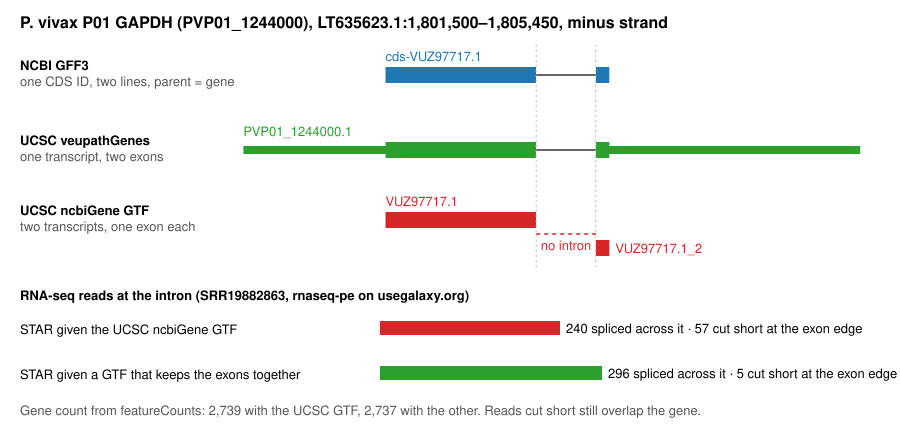

# UCSC GTFs split multi-exon genes into one-exon transcripts

Checked 2026-10-22. The scripts named below are local prototypes, not in this repo.

## Summary

UCSC's GenArk `ncbiGene` GTF, which UCSC builds from NCBI's GenBank annotation, turns some multi-exon genes into separate one-exon transcripts. The gene keeps all its exons, but the GTF has no introns for it. It happens when the GenBank annotation hangs a gene's CDS directly off the gene, or gives it no parent at all, instead of putting an mRNA in between; that is valid GFF3, and UCSC's conversion makes each CDS part its own transcript.

- **How many:** 534 of the catalog's 2,031 `ncbiGene` assemblies have at least one split gene: 124 eukaryotes, 129 viruses and 281 bacteria. In 107 eukaryotes (11% of the 1,008 checked) at least 5% of protein-coding genes are split, and 99 of these have no multi-exon transcripts at all; together they have 757,277 split genes. They include 31 _Plasmodium_, 22 _Aspergillus_ and 17 _Fusarium_ assemblies. The site offers the RNA-seq workflows for all 107.
- **What it changes:** everything built from the GTF's gene structure. BRC offers workflows from IWC, Galaxy's curated workflow collection; the effects below come from the tools those IWC workflows run (STAR, StringTie, SnpEff, gffread) when given UCSC's file, and would be the same for anyone running them with it. Tested on _P. vivax_ P01:
  - **Proteins:** translating the GTF (gffread) reproduces 2,517 of NCBI's 6,517 distinct P01 protein sequences; the rest come out as pieces. A GTF that keeps each gene's exons together reproduces 6,501.
  - **Variant effects:** SnpEff, which the IWC variant-calling workflows run, called all 4,152 test variants at a splice donor site "upstream gene variant" (lowest impact) instead of "splice donor variant" (high impact), and gave each of 4,103 variants inside exons the wrong protein position.
  - **Transcript expression:** StringTie's values stop tracking read counts (rank correlation 0.78, against 0.99), and one-exon genes, which aren't split, fall to 0.44 times their value.
  - **Alignment:** STAR spliced 17% fewer read ends across P01's annotated introns.
- **What it doesn't change much:** gene counts from featureCounts, which only asks whether a read overlaps a gene's exons: 6,671 of 6,836 P01 genes got the same count.



**Check any GTF in one line.** A GTF for an organism with introns should have thousands of multi-exon transcripts:

```sh
curl -sL https://hgdownload.soe.ucsc.edu/hubs/GCA/900/093/555/GCA_900093555.2/genes/GCA_900093555.2_GCA_900093555.ncbiGene.gtf.gz | gzip -dc | awk -F'\t' '$3=="exon"{match($9,/transcript_id "[^"]+"/);n[substr($9,RSTART,RLENGTH)]++} END{for(t in n)if(n[t]>1)m++;print m+0" of "length(n)" transcripts have more than one exon"}'
```

| P01 GTF in UCSC's hub                             | Result                                             |
| ------------------------------------------------- | -------------------------------------------------- |
| `…ncbiGene.gtf.gz` (the catalog's `geneModelUrl`) | 0 of 17,755 transcripts have more than one exon    |
| `veupathGenes.gtf.gz`                             | 4,251 of 6,861 transcripts have more than one exon |

## Example: P01 GAPDH

[UCSC browser at `PVP01_1244000`](https://genome.ucsc.edu/cgi-bin/hgTracks?db=GCA_900093555.2&position=LT635623.1:1801500-1805450)

| Source                            | `PVP01_1244000`                                                                                                    |
| --------------------------------- | ------------------------------------------------------------------------------------------------------------------ |
| NCBI GFF3                         | one CDS, `cds-VUZ97717.1`, on two lines (1,803,758–1,803,841 and 1,802,460–1,803,389), parent `gene-PVP01_1244000` |
| UCSC `veupathGenes` GTF, same hub | one transcript, `PVP01_1244000.1`, with two exons (including UTRs) and the intron 1,803,390–1,803,757              |
| UCSC `ncbiGene` GTF               | two transcripts, `VUZ97717.1` and `VUZ97717.1_2`, one exon each                                                    |
| UCSC browser `ncbiGene` track     | two items named `VUZ97717.1`, one block each                                                                       |
| NCBI GTF                          | `gene`, `CDS`, `start_codon` and `stop_codon` rows; no `exon` rows                                                 |

At that intron, STAR spliced 240 read ends across it with UCSC's `ncbiGene` GTF and 296 with a GTF that keeps the exons together. With UCSC's GTF, 57 read ends were soft-clipped at the upper exon's edge, against 5. The gene's featureCounts count was 2,739 and 2,737 read pairs.

## Is it real?

- **NCBI's and VEuPathDB's annotations agree on the intron.** NCBI's GFF3 and VEuPathDB's annotation, which UCSC publishes in the same hub as `veupathGenes`, give GAPDH the same CDS and the same intron; VEuPathDB's exons also include UTRs. VEuPathDB uses its own sequence names (`PvP01_12_v2`). The two aren't independent: both come from the Sanger Institute (VEuPathDB lists P01's annotation source as GeneDB, and WTSI submitted the GenBank annotation), so the reads below are the independent evidence.
- **The reads cross the introns.** With UCSC's GTF, which gives STAR no introns, STAR still spliced 45,396 read ends exactly across P01's annotated introns, at 5,573 of the 10,918; that is 86% of its spliced read ends. (116 of the 10,918 are gaps under 20 bases, which STAR treats as deletions, not introns.)
- **The rule holds without exception.** In all 2,029 `ncbiGene` assemblies with an NCBI GFF3:
  - 757,617 CDSs in several parts hang off a gene: 757,563 are split in UCSC's GTF, none is intact, 53 are absent from it under any name, and 1 is neither split nor intact.
  - 1,860 CDSs in several parts have no parent: all are split.
  - 7,506,733 CDSs in several parts hang off an mRNA: the 6,560,306 found under the mRNA's ID are all intact; 946,427 couldn't be matched by name, because UCSC renames some mRNAs, and weren't checked.
- **The NCBI files are valid GFF3.** The GFF3 specification lets a CDS hang directly off a gene ([Recommendations for extending the GFF3 specification](https://arxiv.org/pdf/2202.07782)). NCBI's own GTF for these files has no `exon` rows for such genes, so it can't be used either.
- **It's current.** The catalog's P01 GTF matches the live file byte for byte (`Last-Modified` 2024-09-11). No earlier report of this was found.

## Impact

Measured on one _P. vivax_ P01 sample (SRR19882863, PRJNA853709, from a study of schizont-stage transcriptomes; 584,000 read pairs after fastp, 95% uniquely mapped), run through `rnaseq-pe` on usegalaxy.org twice, unstranded, with featureCounts on: once with UCSC's `ncbiGene` GTF, and once with a GTF converted from the same NCBI GFF3 that keeps each gene's exons together (10,918 introns from 4,152 multi-exon genes).

| Measure                                                   | UCSC `ncbiGene` GTF | Converted GTF | Change                                              |
| --------------------------------------------------------- | ------------------- | ------------- | --------------------------------------------------- |
| Read ends spliced across P01's annotated introns          | 45,396              | 54,689        | −17%                                                |
| Crossings of annotated introns (a read end can cross two) | 47,758              | 59,582        | −20%                                                |
| Annotated introns with at least one crossing              | 5,573               | 5,993         | −7%                                                 |
| Read ends soft-clipped (anywhere in the read)             | 119,487             | 110,726       | +8%                                                 |
| Read ends aligned differently                             |                     |               | 11,670 (1.0%)                                       |
| Read pairs featureCounts assigned to genes                | 398,532             | 398,588       | 0.01%                                               |
| Genes whose count differs                                 |                     |               | 165 of 6,836, all multi-exon; 210 read pairs in all |

Alignment rows count read ends (each read pair has two), primary alignments only; featureCounts counts read pairs.

**Changed:** how reads that cross introns are aligned. STAR finds most introns on its own, but without the annotation it splices fewer reads across them and soft-clips more, as at GAPDH's exon edge. The STAR alignments (BAM) and the coverage tracks built from them carry this.

**Barely changed:** gene counts from featureCounts, because a read clipped at an exon edge still overlaps its gene.

### Transcript expression (StringTie)

The same P01 sample, run again with StringTie on (invocations `e7f28d9cedb57519`, UCSC, and `afad563ee72d1b9c`, converted). Genes with at least 20 read pairs in featureCounts:

| Measure                                                      | UCSC `ncbiGene` GTF      | Converted GTF |
| ------------------------------------------------------------ | ------------------------ | ------------- |
| Rows in StringTie's gene table                               | 8,488 for 6,836 genes    | 6,838         |
| Genes with more than one row (same Gene ID)                  | 1,216, up to 9 rows each | 0             |
| Rank correlation of TPM with featureCounts reads per kb      | 0.776                    | 0.993         |
| One-exon genes (not split), median TPM relative to converted | 0.44                     | 1             |
| One-exon genes whose TPM falls by more than 2×               | 1,808 of 1,808           | —             |
| Share of all TPM in one-exon genes (all genes)               | 19%                      | 43%           |

With UCSC's GTF, a split gene's short one-exon pieces each get a TPM of their own, and a few reads on a short piece give a high value. The total is fixed at 10⁶, so genes that aren't split lose. Within the run, split and unsplit genes can't be compared.

### Proteins (gffread)

Proteins translated from each GTF with gffread 0.12.9 (as the CAPHEINE and lncRNA workflows do) and compared with NCBI's protein FASTA for P01 (6,519 records, 6,517 distinct sequences):

| GTF             | Coding transcripts | Equal to an NCBI protein | A piece of an NCBI protein | Distinct NCBI sequences reproduced |
| --------------- | ------------------ | ------------------------ | -------------------------- | ---------------------------------- |
| UCSC `ncbiGene` | 17,591             | 2,523                    | 14,590                     | 2,517 of 6,517                     |
| Converted       | 6,683              | 6,503                    | 13                         | 6,501 of 6,517                     |

The pieces are in frame, so each is a correct part of its protein. Most of the converted GTF's other transcripts are pseudogenes, which have no NCBI protein.

### Variant effects (SnpEff)

SnpEff 5.4c databases were built from each GTF and the P01 genome (`snpEff build -gtf22`), as the haploid and ploidy-aware variant-calling workflows do, and two sets of made-up test variants were annotated with both:

| Test variants                                                    | Converted GTF                                       | UCSC `ncbiGene` GTF                                                                       |
| ---------------------------------------------------------------- | --------------------------------------------------- | ----------------------------------------------------------------------------------------- |
| One base change at the first intron's donor site, 4,152 genes    | all `splice_donor_variant`, HIGH impact             | all `upstream_gene_variant`, MODIFIER (lowest) impact; no splice or intron call           |
| One base change mid-exon in the last coding exon, 4,103 genes    | e.g. `PVP01_API04100` `p.Lys749Glu`, protein of 971 | same effect type, wrong protein position in all 4,103, e.g. `p.Lys224Glu`, protein of 446 |
| Calls flagged `WARNING_TRANSCRIPT_NO_START_CODON` (mid-exon set) | 74                                                  | 3,986                                                                                     |

Because UCSC's GTF has no gene rows, SnpEff also turns pieces that fall outside a gene's first piece into separate genes (`PVP01_0010940.2`). A filter that keeps HIGH-impact variants would keep all 4,152 splice-site variants with the converted GTF and none with UCSC's.

### A second organism: _Fusarium graminearum_ PH-1

One sample (SRR26937815, PRJNA1044545; ENA title "PH-1-TBI", from a study described as strand-specific but run here unstranded; 10.9 million read pairs, 95% uniquely mapped), run through `rnaseq-pe` twice with featureCounts and StringTie on: once with UCSC's `ncbiGene` GTF for `GCA_900044135.1` (invocation `fab94f45d8987b76`), and once with FungiDB's GTF for the same assembly, which UCSC publishes in the same hub as `veupathGenes` (sequence versions added; invocation `a6c0e019d02f4f8c`). FungiDB's GTF has 25,492 introns.

This GFF3 is shaped differently from P01's: each gene has an mRNA whose one exon spans the whole gene, introns included, and the CDS in parts hangs off the gene beside it. UCSC's GTF keeps both: the whole-gene span as one transcript, and the CDS parts as one-exon transcripts.

| Measure                                                              | UCSC `ncbiGene` GTF | FungiDB GTF | Change         |
| -------------------------------------------------------------------- | ------------------- | ----------- | -------------- |
| Read ends spliced across FungiDB's introns                           | 3,585,608           | 3,990,439   | −10%           |
| Crossings of FungiDB's introns                                       | 4,050,019           | 4,640,301   | −13%           |
| Introns with at least one crossing                                   | 15,805              | 16,271      | −3%            |
| Read ends soft-clipped (anywhere in the read)                        | 2,806,661           | 2,394,466   | +17%           |
| Read ends aligned differently                                        |                     |             | 554,325 (2.7%) |
| Read pairs featureCounts assigned to genes                           | 9,515,791           | 9,512,229   | 0.04%          |
| Genes with ≥50 read pairs whose count differs by more than 1.5×      |                     |             | 6 of 7,249     |
| Rank correlation of StringTie TPM with reads per kb (≥20 read pairs) | 0.964               | 0.978       |                |
| Multi-exon genes (≥20 read pairs) whose StringTie TPM differs by >2× |                     |             | 170 of 6,744   |

Alignment changes as in P01. Gene counts barely change. StringTie changes much less than in P01, probably because the whole-gene span gives each gene one transcript covering all its reads; not tested.

### IWC workflows the site offers that read the GTF

| Workflow                                 | Tool reading the GTF                      | Uses gene structure for                                                                                                        | Tested here                    |
| ---------------------------------------- | ----------------------------------------- | ------------------------------------------------------------------------------------------------------------------------------ | ------------------------------ |
| RNA-seq (`rnaseq-pe`, `rnaseq-sr`)       | STAR, featureCounts, StringTie, Cufflinks | splice junctions; transcript expression                                                                                        | STAR, featureCounts, StringTie |
| Haploid and ploidy-aware variant calling | SnpEff build                              | variant effects on proteins and splice sites                                                                                   | yes (SnpEff 5.4c)              |
| CAPHEINE (HyPhy selection)               | gffread, then remove terminal stop codons | coding sequences compared across species                                                                                       | proteins (gffread)             |
| lncRNA annotation                        | gffread, StringTie, FEELnc                | known mRNAs, used to tell coding from noncoding transcripts                                                                    | no                             |
| Single-cell 10x (v3 and CellPlex)        | STARsolo                                  | splice junctions; gene assignment                                                                                              | no                             |
| Viral variant calling                    | SnpEff build                              | variant effects; offered for 13 paramyxoviruses, 5 with 1–2 split genes (e.g. the measles V protein, made from an edited mRNA) | no                             |

**Not measured:** Cufflinks, the lncRNA and single-cell workflows, deeper samples, and organisms with longer introns. Ortholog sets published by NCBI, VEuPathDB or OrthoMCL are built from the published proteins and are not affected; anything built from proteins translated out of these GTFs would get pieces.

## How often

Every `ncbiGene` GTF in the catalog was compared with its NCBI GFF3 (exact check below). An assembly counts as affected when at least 5% of its protein-coding genes are split: split CDSs as a share of all CDS IDs in NCBI's GFF3. The 390 `ncbiRefSeq` GTFs were checked only by the shape of their transcripts. The catalog's `augustus` GTFs have a different problem (see [ucsc-gtf-augustus-no-exons-findings.md](ucsc-gtf-augustus-no-exons-findings.md)).

| GTF track and group          | Checked                         | Any split gene | ≥5% of genes split | Of those, no multi-exon transcripts |
| ---------------------------- | ------------------------------- | -------------- | ------------------ | ----------------------------------- |
| `ncbiGene` eukaryotes        | 1,008 (1 more has no NCBI GFF3) | 124            | 107                | 99                                  |
| `ncbiGene` viruses           | 622                             | 129            | 121                | 118                                 |
| `ncbiGene` bacteria, archaea | 399 (1 more has no NCBI GFF3)   | 281            | 0                  | —                                   |
| `ncbiRefSeq` eukaryotes      | 390 (shape only)                | 0              | 0                  | —                                   |

At 1% the eukaryote count is 110; at 10%, 104. The eukaryote without an NCBI GFF3, _Echinococcus granulosus_ (`GCA_000469785.1`), has a UCSC GTF of the same shape, with an estimated 79% of genes split.

**Viruses:** 316 multi-part CDSs split in 129 assemblies. Not all are spliced genes: some are made from an edited mRNA (paramyxovirus V, filovirus GP) or read through a ribosomal frameshift (retrovirus _gag-pol_). By family: herpesviruses 89, adenoviruses 53, anelloviruses 36, retroviruses 26, influenza viruses 24; the single species with the most is influenza A (20). Viral genomes have few genes, so one or two split genes pass 5%.

**Bacteria:** 1,498 multi-part CDSs split in 281 assemblies, a median of 1 each: genes read through a programmed frameshift, such as _E. coli_'s `prfB` (`NP_417367.1` and `NP_417367.1_2`), and frameshifted pseudogenes. The most is 238, in _Shigella sonnei_ `GCF_002950395.1`.

| Genus       | Assemblies | Genes split | Species                                                                                                                                                                                           |
| ----------- | ---------- | ----------- | ------------------------------------------------------------------------------------------------------------------------------------------------------------------------------------------------- |
| Plasmodium  | 31         | 51–71%      | _P. vivax_, _P. ovale_, _P. malariae_, _P. berghei_, _P. chabaudi_, _P. vinckei_, _P. yoelii_, ape _Plasmodium_                                                                                   |
| Aspergillus | 22         | 77–81%      | _A. niger_, _A. tubingensis_, _A. terreus_, _A. brasiliensis_, _A. luchuensis_, _A. lentulus_                                                                                                     |
| Fusarium    | 17         | 72–80%      | _F. fujikuroi_, _F. graminearum_, _F. oxysporum_ and others                                                                                                                                       |
| Others      | 37         | 5–96%       | _Eimeria_ (2), _Babesia ovis_, _Cryptosporidium hominis_ `GCA_002223825.1`, _Echinococcus multilocularis_, _Pneumocystis jirovecii_, _Ixodes_ ticks (2), nematodes (4), smut fungi (7) and others |

Eight of the 107 also have some multi-exon transcripts. Two hang some CDSs off mRNAs: _Pythium insidiosum_ (`GCA_001029375.2`, 4,778 multi-exon transcripts, 2,368 split genes) and _Phakopsora pachyrhizi_ (`GCA_943846425.1`, 10,543 and 12,019). The other six have no mRNA rows and 1–194 multi-exon transcripts each, not traced.

## Cause

In UCSC's `ncbiGene` GTF, a CDS in several parts is one transcript only when its parent is an mRNA. When its parent is the gene, or it has no parent, each part becomes a transcript, named after the CDS (`VUZ97717.1`, `VUZ97717.1_2`, …) or, for some pseudogenes, after the gene. Pseudogenes are split the same way.

Whether a GFF3 has mRNA rows doesn't decide it: _Fusarium graminearum_ (`GCA_900044135.1`, 14,145 mRNA rows) and _Ixodes hexagonus_ (`GCA_964199285.2`, 19,482) still hang 10,634 and 13,810 CDSs off the gene.

| Assembly                               | mRNA rows | CDS in parts, parent gene | CDS in parts, no parent | Split in UCSC GTF | CDS in parts, parent mRNA (intact) | UCSC multi-exon transcripts |
| -------------------------------------- | --------- | ------------------------- | ----------------------- | ----------------- | ---------------------------------- | --------------------------- |
| _P. vivax_ P01 `GCA_900093555.2`       | 0         | 4,152                     | 0                       | 4,152             | 0                                  | 0                           |
| _A. niger_ `GCA_027923865.1`           | 0         | 9,510                     | 0                       | 9,510             | 0                                  | 0                           |
| _E. multilocularis_ `GCA_000469725.3`  | 0         | 8,071                     | 1,263                   | 9,333             | 0                                  | 0                           |
| _F. graminearum_ `GCA_900044135.1`     | 14,145    | 10,634                    | 0                       | 10,634            | 0                                  | 0                           |
| _I. hexagonus_ `GCA_964199285.2`       | 19,482    | 13,810                    | 0                       | 13,803            | 0                                  | 0                           |
| _P. insidiosum_ `GCA_001029375.2`      | 8,548     | 2,368                     | 0                       | 2,368             | 4,576 (4,576)                      | 4,778                       |
| _Blumeria graminis_ `GCA_900519115.1`  | 8,470     | 40                        | 0                       | 40                | 5,007 (5,007)                      | 5,048                       |
| _F. oxysporum_ `GCA_000260215.2`       | 26,246    | 0                         | 0                       | 0                 | 18,837 (18,837)                    | 20,339                      |
| _Ixodes persulcatus_ `GCA_013358835.2` | 28,510    | 0                         | 0                       | 0                 | 22,335 (22,335)                    | 22,335                      |

## Method

1. **Exact check** (`truth_split2.py`): every CDS ID in NCBI's GFF3 with two or more lines, classified by its parent (gene, mRNA, none), was looked up in UCSC's GTF under the mRNA's ID (for mRNA-parented CDSs), then its protein ID, name, ID, gene symbol and locus tag, with numbered pieces `X`, `X_2`, …. Split: two or more one-exon transcripts. Intact: one transcript with at least as many exons as the CDS has parts. Each downloaded file was checked as a complete gzip, and its md5 recorded with the result. All 2,031 catalog `ncbiGene` assemblies; 2,029 have an NCBI GFF3.
2. **Share of genes split:** split CDSs ÷ all CDS IDs in NCBI's GFF3 (about one per protein-coding gene).
3. **Shape scan:** the 390 `ncbiRefSeq` GTFs were checked for one-exon transcripts named `X`, `X_2`, … within 5 kb of each other in one gene; none had 10 or more.
4. **Reads** (`bam_junctions.py`): the two runs' STAR BAMs were compared read end by read end (primary alignments), and splices were matched to the converted GTF's introns.
5. **Not matched:** 53 gene-parented CDSs are absent from UCSC's GTF under any name; not investigated.

## Claims and evidence

| #   | Claim                                                                      | Evidence                                                                                                                       |
| --- | -------------------------------------------------------------------------- | ------------------------------------------------------------------------------------------------------------------------------ |
| 1   | UCSC splits a gene-parented or parentless CDS into one transcript per part | Exact check of 2,029 GFF3s against UCSC GTFs; P01 GAPDH rows above                                                             |
| 2   | UCSC keeps an mRNA-parented CDS together                                   | Same check: all 6,560,306 found under the mRNA's ID are intact; 946,427 not matched by name                                    |
| 3   | The UCSC browser shows the same split                                      | UCSC API `getData/track`, `ncbiGene`, `LT635623.1:1802400-1803900`: two one-block items named `VUZ97717.1`                     |
| 4   | The introns are real                                                       | VEuPathDB annotation (UCSC `veupathGenes`) has them; 45,396 read ends spliced across them with no annotation                   |
| 5   | NCBI's GTF has no `exon` rows for these genes                              | NCBI `*_genomic.gtf.gz`: P01, 153 `exon` rows, all noncoding RNA; _A. niger_, 356, all tRNA or rRNA; _E. praecox_, none        |
| 6   | The IWC RNA-seq workflows give the GTF to STAR for introns                 | `rnaseq-pe` STAR step: `sjdbGTFfile` from the GTF input, `sjdbGTFfeatureExon: exon`                                            |
| 7   | Alignment changes; gene counts barely do                                   | Two `rnaseq-pe` runs on usegalaxy.org: invocations `38907e8cc593abda` (UCSC) and `519682767952fc22` (converted); BAMs compared |
| 8   | The site offers the IWC RNA-seq workflows for all 107                      | Both need only a Galaxy datacache entry (`build-workflow-mappings.ts`); all 107 have `galaxyDatacacheUrl`                      |
| 9   | The P01 file is current                                                    | Cached and live `ncbiGene.gtf.gz` identical; `Last-Modified` 2024-09-11                                                        |

The `rnaseq-pe` runs used IWC `main`, not the catalog's v1.4: STAR and featureCounts are the same versions with the same settings.

## Not known

- Effect on Cufflinks and on the lncRNA and single-cell workflows.
- Effect on deeper samples and on organisms with longer introns.
- How many analyses on the site have used an affected GTF.
- Whether UCSC considers this a bug.
